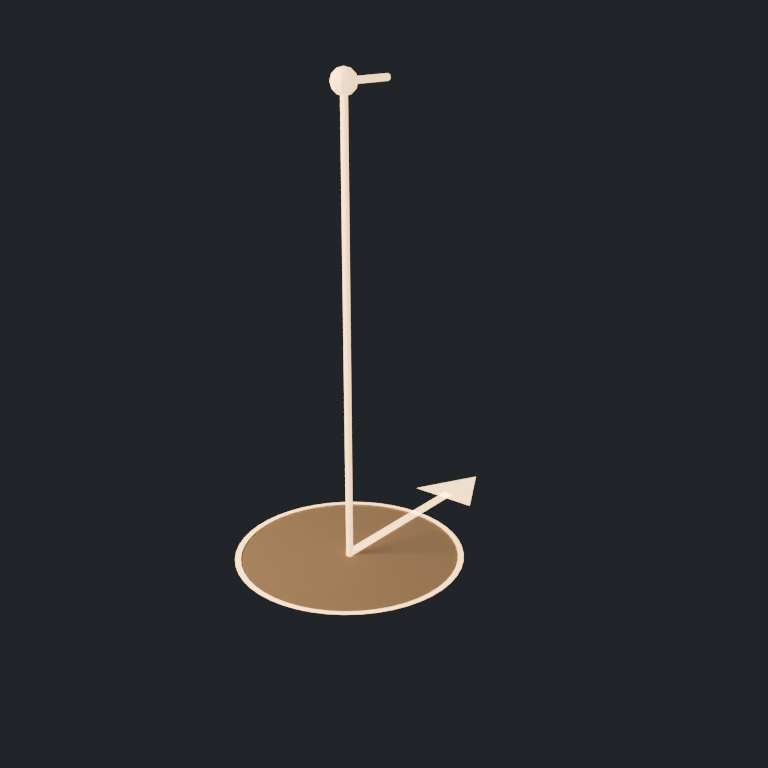

# Actors

## Player start marker (`tools/blender/create_player_start.py`)



What the level designer sees where the player will begin; never drawn in play (its
prefab carries `HiddenInGame`). Origin on the ground at the footprint's centre, so it
snaps to the floor when dropped.

- **Footprint:** a 0.4 m ring and faint disc, about a standing player's footprint.
- **Facing:** an arrow on the ground along Bevy's forward (−Z): the way the player
  looks at the start. Rotate the marker to aim it.
- **Eye:** a post to 1.65 m (`controls::EYE_HEIGHT`) with a forward sight tick: where
  the camera starts.

In the build colour (`#ffd39a`), emissive so it reads in dark scenes. 299 triangles.
The prefab (`prefabs/actors/player_start.bsn`: this model, `HiddenInGame`,
`PlayerStart`) follows once the game's `PlayerStart` component exists
(`add-opening-region` 2.7).

```sh
~/.local/bin/blender -b --factory-startup -P tools/blender/create_player_start.py
```
