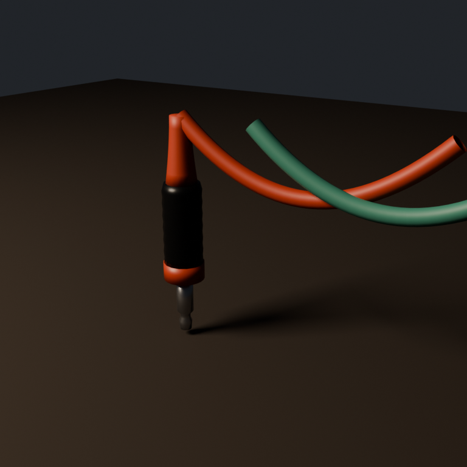

# Cables

## Patch cable (`tools/blender/create_patch_cable.py`)



The general cable that patches any module jack to any other, in the HUD rack and in
the world. Two parts:

- **The plug** (`models/cables/patch_plug.glb`): a titanium sleeve that fits the
  module jacks (3.5 mm at the world's x10 scale), a knurled graphene grip, and a
  coloured collar and strain relief. Seat it by giving its root a jack's `Port_<port>`
  transform; the cable leaves from `Cable_attach`.
- **The cable**, drawn by the game: a tube between two plugs' `Cable_attach` points,
  **fully elastic as in VCV Rack**. It has no length; drag an end and it stretches.
  Its droop is VCV Rack's: a quadratic Bezier through the midpoint pulled down by
  `(1 - tension) * (slump_base_m + span)`, tension 0.5 by default, `slump_base_m`
  0.508 (VCV's 150 px is 10 HP, at x10). `cable_curve()` in the generator is the
  reference.

Colours (tint `PatchCable_Cable` and `PatchCable_Collar`): rust, ochre, verdigris,
slate, bone; by default gate cables are verdigris, audio rust, CV ochre. Cables are
not emissive.

The burbler's configuration screen shows the first patch: `docs/art/hud_mock.png`.

```sh
~/.local/bin/blender -b --factory-startup -P tools/blender/create_patch_cable.py
```
