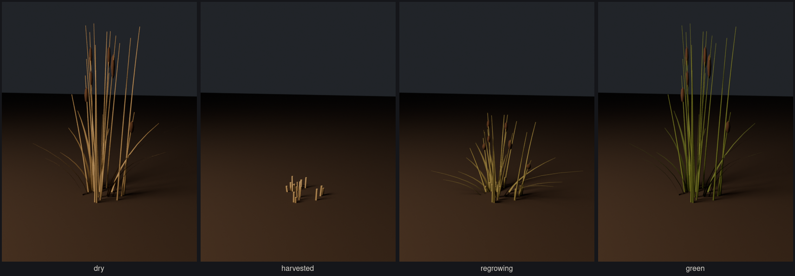
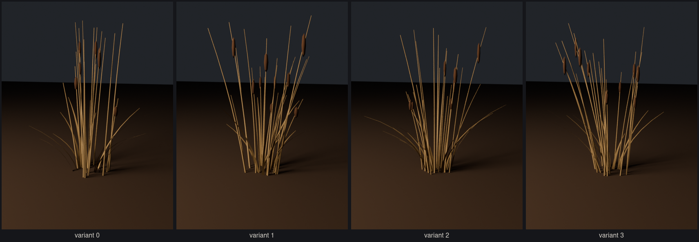
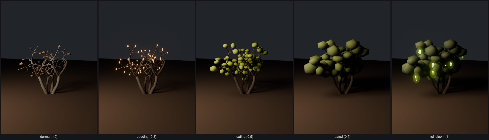
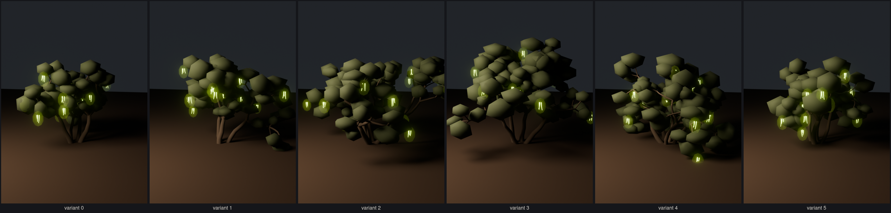
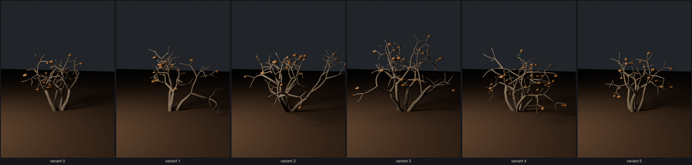

# Flora

## Reeds (`tools/blender/create_reeds.py`)



The stream's ingredient: **6 reeds build one stream segment**, and reeds then outline
the segment's banks (`openspec/changes/add-reeds/`). A frequent renewable, as easy to
get as leaves in Satisfactory. A clump
is a stand of tall reeds with a few cattail heads. Harvesting it with E cuts it to
stubble; it returns after the catalog's short replenishment interval, and the game may
scale `Standing` up from stubble height to show it coming back. Greenness (0 dry,
1 green) recolours stalks and blades.



Four seeded variants (`models/reed_clump_<k>.glb`) plus per-instance scale, height,
yaw, sway phase and greenness from the world seed and instance ID. Nodes: `Interact`,
`Standing` (with `Sway_0..2`, pivots at the ground), `Stubble`, `LOD_Far` (crossed
strips, beyond 30 m). 1.4k–1.7k triangles near, 6 far; contract in `reeds/asset.json`.

```sh
~/.local/bin/blender -b --factory-startup -P tools/blender/create_reeds.py
```

## Scrub oak (`tools/blender/create_scrub_oak.py`)



The infinite mine that produces lightning bugs: a low, many-stemmed desert oak about
2.5–4 m tall. It **starts dormant, in winter**: grey bare wood, tight buds, a few dry
leaves still clinging. **Clean water wakes it.** One growth value, 0 to 1, rises as
clean water is delivered and escalates it through budding, leaf-out and leafed to
**full bloom**, when luminous catkins hang from the crown. Each bloom carries a
`BugSpawn_<k>`, so only open blooms produce bugs and a dormant tree makes none.




### Tree-to-tree variation

Two layers, so no two trees in the world match:

1. **Variants.** The generator grows each tree from a seed: stem count and lean,
   branch splits, angles and lengths, leaf clusters, dry leaves, bloom positions and
   their opening order. Six seeds are exported as `models/scrub_oak_<k>.glb`.
2. **Per instance (game).** Each placed tree picks a variant with
   `hash(world_seed, instance_id) % 6` and draws scale, height stretch, yaw, lean,
   sway phase, leaf value jitter and bloom tint from `per_instance` in
   `scrub_oak/asset.json`, seeded the same way.

More variants are one more seed in `VARIANTS`.

### Growth mapping

`scrub_oak/asset.json` → `growth` holds the whole mapping. Each change is a smoothstep
over a `[from, to]` range of growth; the previews are rendered through the same code
(`set_growth`).

| Growth | What changes |
| ------ | ------------ |
| 0–0.4 | bark warms from dormant grey `#625d57` to living `#4b4037` |
| 0.08–0.25 | dry winter leaves (`Dead_<n>`) fall |
| 0.1–0.3 | buds (`Bud_<n>`) swell and glow faint amber |
| 0.35–0.65 | leaves (`Foliage_<n>`) grow out; buds open (0.42–0.55) |
| 0.45–0.8 | leaves mature from young `#7b8c3c` to `#36412a` |
| 0.72–1.0 | blooms (`Bloom_<k>`) open one by one in `order` |

What drives growth is a gameplay decision for `add-scrub-oak-production`: clean water
delivered to the tree raises it; muddy water does not wake it.

### Nodes

`Limb_<n>` (one per stem, pivot at its base; sway it), `Dead_<n>`, `Bud_<n>`,
`Foliage_<n>`, `Bloom_<k>` (extras: `order`), `BugSpawn_<k>`, and the far LOD
`LOD_Far_Bark` / `LOD_Far_Foliage` (extras: `lod = far`; swap in beyond 45 m). Every
part of a stem is parented to its limb, so it sways together.

Triangles: 11.0k–14.7k near, 0.8k–1.1k far LOD.

```sh
~/.local/bin/blender -b --factory-startup -P tools/blender/create_scrub_oak.py         # all variants
~/.local/bin/blender -b --factory-startup -P tools/blender/create_scrub_oak.py -- 3    # one variant
~/.local/bin/blender -b --factory-startup -P tools/blender/create_scrub_oak.py -- montage
```
