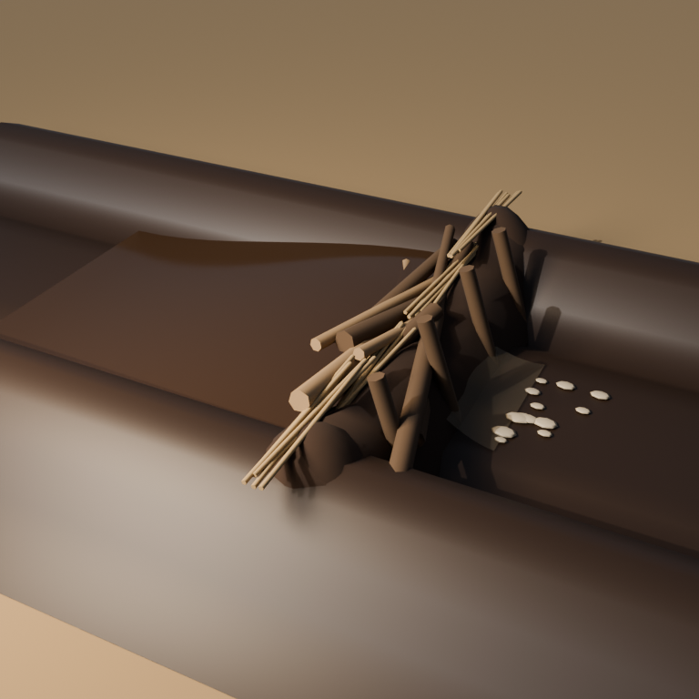

# Machines

Every machine is an instrument: a placed model with a rack the player patches and plays
(`bevy_stubby_rack`; a machine's rack is data, the `configure` block in its `asset.json`).
Its tuning targets and clock reach are rules (`assets/recipes/machines.json`).

## Mudpit burbler (`tools/blender/create_burbler.py`)

The game's clock source: a round pool of mud bubbling on its beat, a resource node the
player configures rather than picks up (E opens its rack: clock, VCO place, volume). A
patched burbler sounds, and its stream carries the music. Placed in the opening scene and
by the seeded layout; each instance seeds its tempo on the 24 BPM grid.

## Reed water purifier (`tools/blender/create_stream_features.py`)



A check dam of sticks and reed bundles packed with mud across a laid stream, the water
pooled behind it and spilling through a notch (`add-reed-water-purifier`). Crafted at a
burning campfire as a `reed_water_purifier_kit`, then built from it with Q: its
`placement` is `across_segment`, so the hologram snaps across the aimed segment and is
red elsewhere. The dam keeps the segment it stands on and goes with it, refunded, when
that segment is dismantled.

Its rack: a borrowed clock, saw and triangle VCOs, mixer, VCF, volume and scope, copied
from the user's VCV patch (`assets/rack-recipies/reed-water-filter.vcv`). Tuned (low VCO
C2, high VCO C4, cutoff C5) and sounding, it lifts the water below it one clarity stage;
dams in sequence reach clear. Nodes: `Interact` (configure), `Outlet` (`clarity_lift`),
`Pond`, `Spill`, `Foam_<n>`; LOD0/LOD1.

```sh
~/.local/bin/blender -b --factory-startup -P tools/blender/create_stream_features.py -- reed_water_purifier
```
