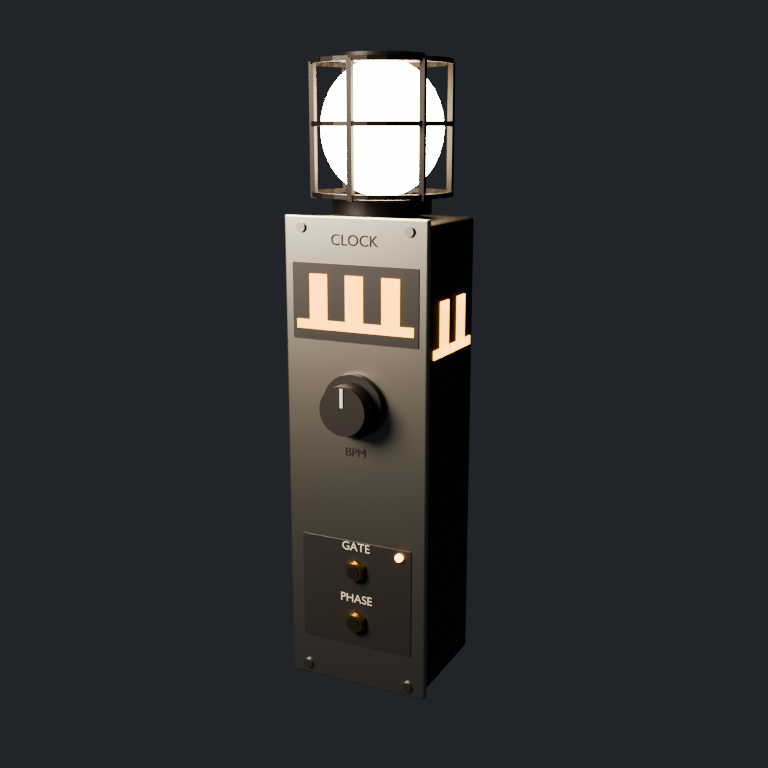
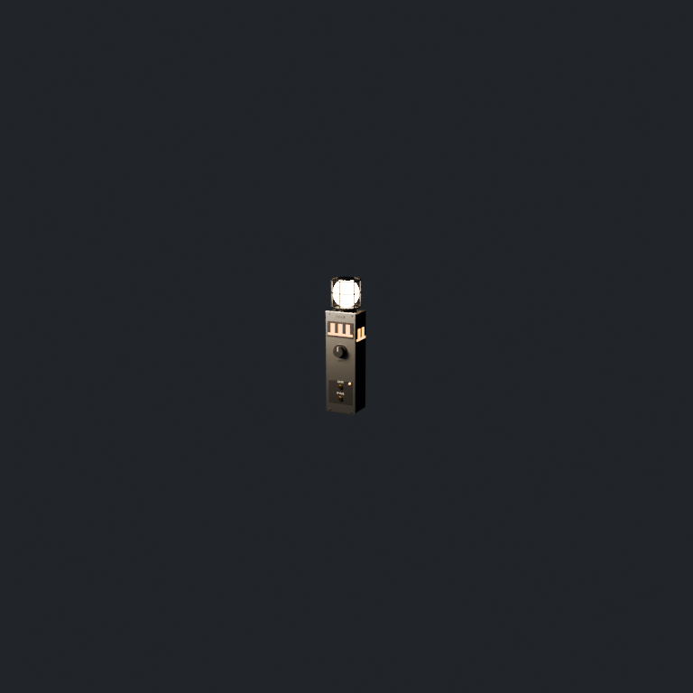
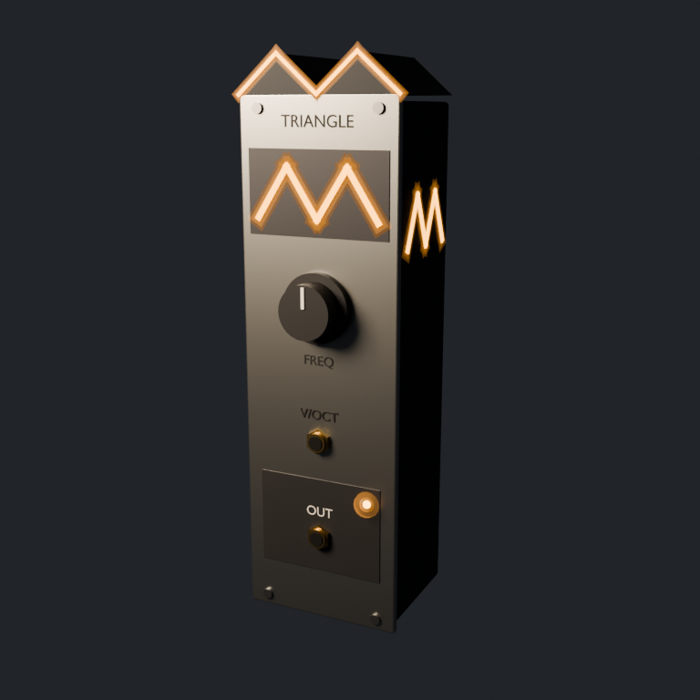
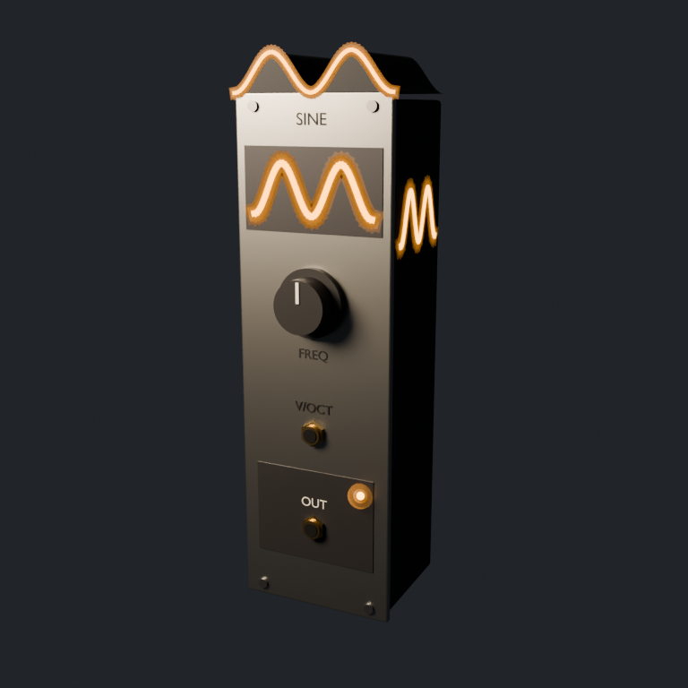
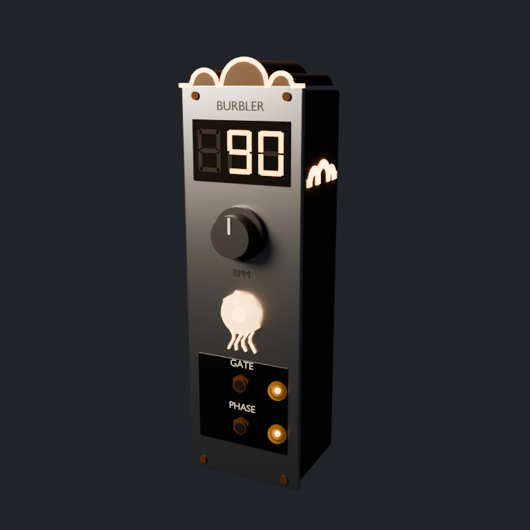

# Modules

Synth modules as world-scale Eurorack modules: 3U panels, ×10 scale (1.285 m tall
before anything on top). Every module comes from a generator script in
`tools/blender/`, which is the source of truth. The scripts share
`tools/blender/module_kit.py` (materials, case, knobs, jacks, labels, glyph strokes,
preview and export). It writes the `.blend` to
`assets-src/blender/modules/`, the `.glb` to `assets/models/modules/`, and `asset.json`,
`preview.png` and `preview_far.png` (the same view from about 12 m) here.

## Clock (`tools/blender/create_clock_lamp.py`)

| Close | About 12 m |
| --- | --- |
|  |  |

The opening's second discovery, and the clock that manifests as a pulsating light. It
is a tempo module in the spirit of performance clock modules: a **BPM readout** and a
**flashing clock light**.

- **Display:** three seven-segment digits in a dark window, with faint unlit "8"s
  behind them. Each segment is a node, `Display_d<digit>_<a-g>` (extras `digit`,
  `segment`), so the game shows any tempo by toggling segments. `asset.json` carries
  the digit-to-segment table. The preview shows 120.
- **Clock light:** a large domed lens, the `Lamp` node. One flash material
  (`Clock_Lamp`) lights the lens, the tick-train crown along the top, and the glyphs on
  both sides, so the beat reads from a distance and from any side, and the game
  modulates a single material per tick. The `Lamp` extras use the lightning bug's
  envelope fields (`attack_seconds`, `flash_seconds`, `rest_strength`,
  `peak_strength`, `light_lumens`, `light_range_metres`, `pulse_driver`). The previews
  show the flash at its peak.
- **Controls:** a TEMPO encoder (`Knob_bpm`), and GATE and PHASE outputs, each with an
  LED (`Light_gate`, `Light_phase`). The engine's Clock has no inputs.

```sh
~/.local/bin/blender -b --factory-startup -P tools/blender/create_clock_lamp.py
```

## VCOs (`tools/blender/create_vco.py`)

| Square | Saw | Triangle | Sine |
| --- | --- | --- | --- |
|  |  |  |  |

8HP oscillators: one FREQ knob, a V/OCT input, and an OUT output on the dark patch
outputs conventionally sit on. Each waveform must read from a distance, so it appears
at three scales:

- **Silhouette:** the case's crown *is* the waveform, traced in amber along its front
  edge. Silhouettes survive haze, where detail does not.
- **Faceplate:** a large amber glyph on a dark recessed plate.
- **Sides:** the same glyph on both sides (mirrored on the left, so it reads correctly
  from outside), so it reads from any angle.

Square is the opening's first discovery. The engine has `SineVco` and `SquareVco`
today; saw and triangle are ready for when it gains those oscillators.

```sh
~/.local/bin/blender -b --factory-startup -P tools/blender/create_vco.py           # all four
~/.local/bin/blender -b --factory-startup -P tools/blender/create_vco.py -- saw    # one
```

The script only creates its own scene, so it is also safe to run inside an open
Blender (for example through MCP); there it writes only the `.blend`.

### Game-facing nodes

Named empties carry glTF extras the game reads (`<Prefix>` is `SquareVco`, `SawVco`,
`TriangleVco` or `SineVco`):

| Node | Extras | Use |
| ---- | ------ | --- |
| `<Prefix>_Root` | `asset_id`, `module_kind`, `waveform`, `scale` | Identify the module |
| `Port_voct`, `Port_out` | `port`, `direction` | Cable sockets; local +Z points out of the panel |
| `Knob_freq` | `param`, `param_min`, `param_max`, `taper`, `rotation_degrees` | Rotate about local Z to show the parameter |
| `Light_out` | `light`, `rest_strength`, `peak_strength` | Drive the LED's emissive strength from the rack's light value |
| `Lamp` (Clock only) | `light`, `pulse_driver`, flash envelope | The clock light; flash `Clock_Lamp` and a point light on each tick |
| `Display`, `Display_d<n>_<seg>` (Clock only) | `display`, `digit`, `segment` | Seven-segment BPM readout |

Origin at the base centre; the faceplate faces glTF +Z. Tilting a module or sinking it
into the mud happens at placement (`placement` in `asset.json`), so one asset serves
every pose. `crates/stubby_game/tests/module_assets.rs` checks these nodes in every
exported module. The Clock's equivalents are `Port_gate`, `Port_phase`, `Knob_bpm`,
`Light_gate` and `Light_phase`.

## Burbler HUD modules (`tools/blender/create_hud_modules.py`)

| Burbler clock | Volume |
| --- | --- |
|  |  |

The modules in a mudpit burbler's configuration HUD (`add-mudpit-burbler`), with a VCO
in the middle place: see `docs/art/hud_mock.png`. They are the first modules in the
style guide's newer language: a weathered wood case and rusted iron hardware behind a
titanium faceplate, outputs on graphene, and light like jellyfish and fairies (a bright
core in translucent shells) instead of LEDs.

- **Burbler clock** (8HP, engine `Clock`): the burbler's own beat. Its tempo belongs to
  the burbler, so it has **no tempo knob** (`params` is empty; `tempo.source` is
  `burbler`): a read-only BPM display (the same segment nodes as the Clock), a
  jellyfish-bell `Lamp` that flashes on the beat (`BurblerClock_Lamp`, translucent so
  bell and core flash together; the previews show it mid-flash), and GATE and PHASE
  outputs with soft lights (`Light_gate`, `Light_phase`). Crown: a row of bubbles.
- **Volume** (4HP, engine `Vca`): one large knob (`Knob_gain`, 0–1) in a soft ring of
  light (`Light_level`), IN and OUT jacks. The VCA's `cv` input is driven inside the
  HUD voice by a hidden envelope, so it has no jack (`internal_ports`). Crown: a rising
  wedge, repeated on the faceplate and both sides.

```sh
~/.local/bin/blender -b --factory-startup -P tools/blender/create_hud_modules.py
~/.local/bin/blender -b --factory-startup -P tools/blender/render_hud_mock.py   # docs/art/hud_mock.png
```
