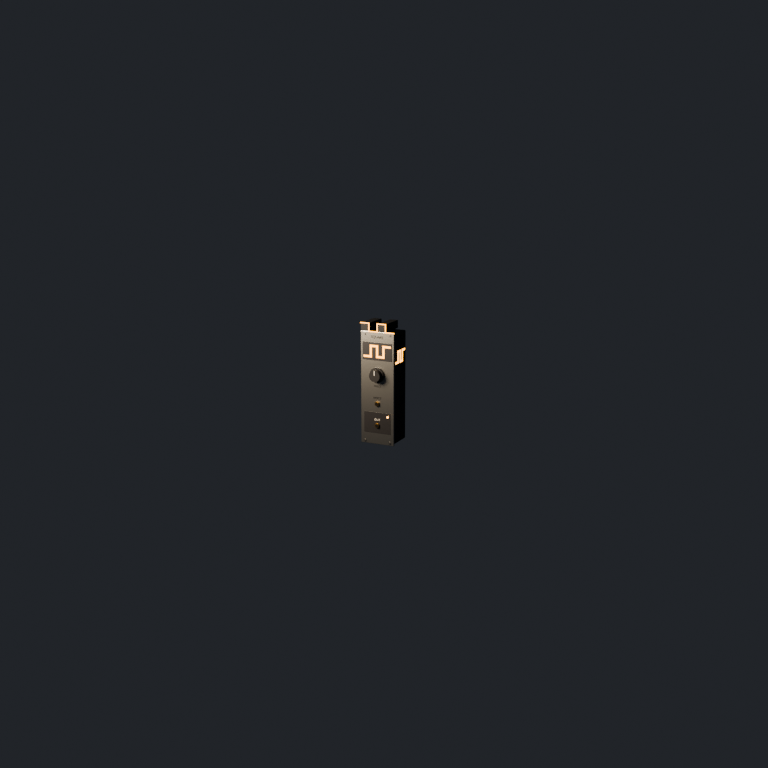

# Square VCO

The opening's first discovery: a square-wave oscillator, built as a world-scale
Eurorack module (3U, 8HP, ×10: a 1.285 m panel, 1.375 m with its crown, 0.41 m wide).
Weathered dark case, brushed faceplate, one FREQ knob, a V/OCT input, and an OUT
output on the dark patch outputs conventionally sit on.

The square wave has to read from a distance, so it appears at three scales:

- **Silhouette:** the case is crowned with a square wave (high, low, high, low) and
  traced in amber along its front edge. It survives haze, where detail does not.
- **Faceplate:** a large amber glyph on a dark recessed plate.
- **Sides:** the same glyph on both sides, so it reads from any angle.

| Close | About 12 m |
| --- | --- |
|  |  |

- Source: `assets-src/blender/square_vco.blend` (generated; see below).
- Runtime: `assets/models/square_vco.glb`. Origin at the base centre; the faceplate
  faces glTF +Z.
- Profile: `asset.json`.

## Game-facing nodes

Named empties carry glTF extras that the game reads:

| Node | Extras | Use |
| ---- | ------ | --- |
| `SquareVco_Root` | `asset_id`, `module_kind`, `scale` | Identify the module |
| `Port_voct`, `Port_out` | `port`, `direction` | Cable sockets; local +Z points out of the panel |
| `Knob_freq` | `param`, `param_min`, `param_max`, `taper`, `rotation_degrees` | Rotate about local Z to show the parameter |
| `Light_out` | `light`, `rest_strength`, `peak_strength` | Drive the LED's emissive strength from the rack's light value |

Tilting the module or sinking it into the mud is done at placement (see
`placement` in `asset.json`), so one asset serves every pose.

## Rebuild

The generator script is the source of truth. It rebuilds the `.blend`, the `.glb`,
`preview.png` and `preview_far.png`:

```sh
~/.local/bin/blender -b --factory-startup -P tools/blender/create_square_vco.py
```

It only creates its own scene, so it is also safe to run inside an open Blender
session (for example through MCP); there it writes only the `.blend`.
