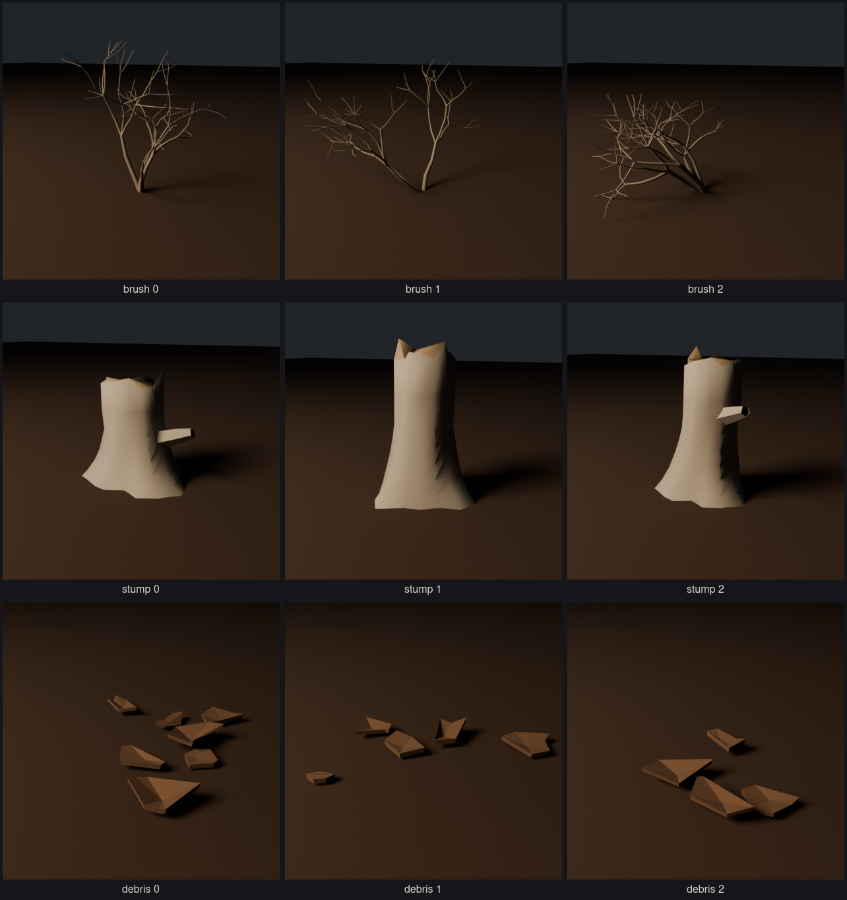
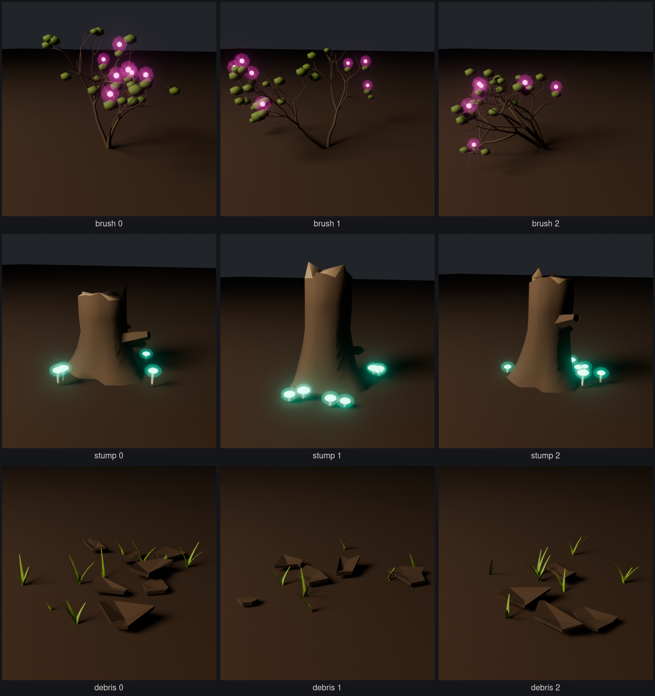

# Props

## Desert props (`tools/blender/create_desert_props.py`)

The bleak opening's scatter, each with its bloomed counterpart (`add-art-direction` 2.6).




| Family | Bleak | Bloomed | Triangles |
| ------ | ----- | ------- | --------- |
| `desert_brush_<k>` | low grey twiggy dead shrub | small leaf clusters, a few luminous magenta flowers | 2.9k–4.4k |
| `desert_stump_<k>` | bleached snag, jagged break, flared roots | wood darkens with damp, moss, luminous cyan mushrooms at its foot | 1.3k–1.7k |
| `desert_debris_<k>` | scatter of curled, broken mud plates | sprouts pushing up between the plates | 0.2k–0.3k |

**Bloom** (0 bleak .. 1 bloomed) follows the local light quality, the field that blends
the world from bleak to bloomed. Each `Bloom_<n>` node scales in over its own slice
of the range (extras `from`, `to`), so a prop blooms gradually; `DesertBrush_Twig`,
`DesertStump_Wood` and `DesertDebris_MudPlate` blend bleak → bloomed colour with it.
Props ship bleak.

Three seeded variants per family, plus per-instance scale, yaw and tilt from the world
seed and instance ID. Contract: `desert/asset.json`.

```sh
~/.local/bin/blender -b --factory-startup -P tools/blender/create_desert_props.py
~/.local/bin/blender -b --factory-startup -P tools/blender/create_desert_props.py -- stump 1
```
