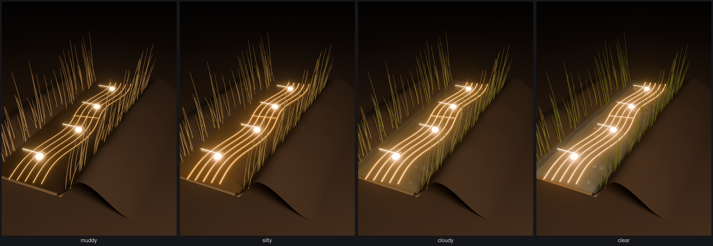
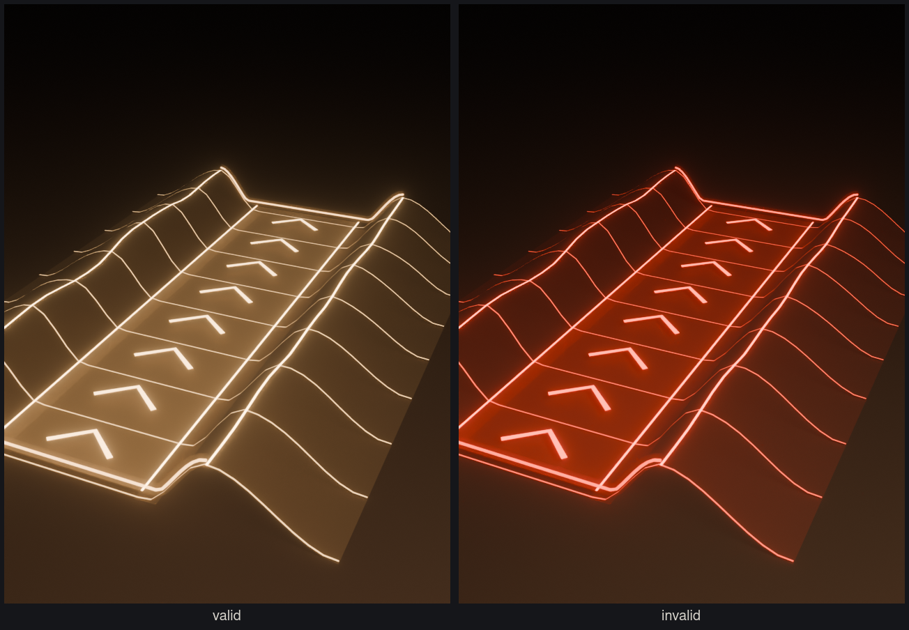
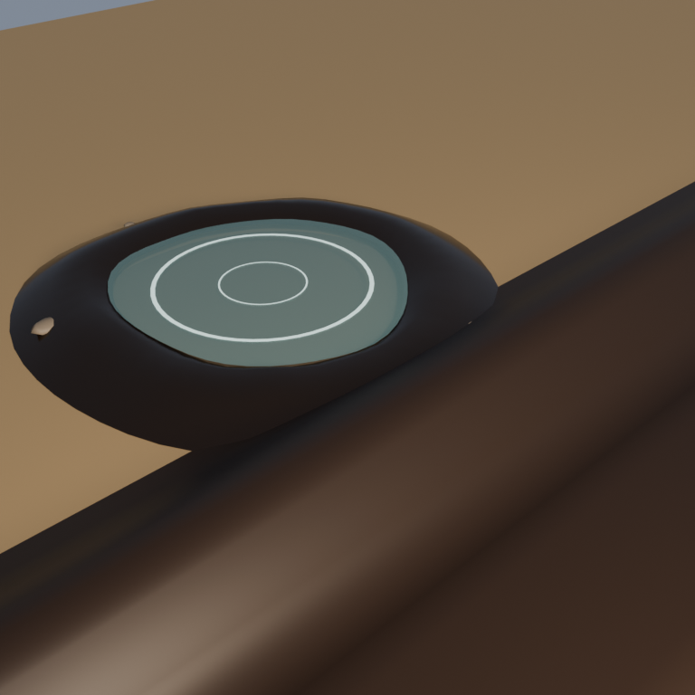
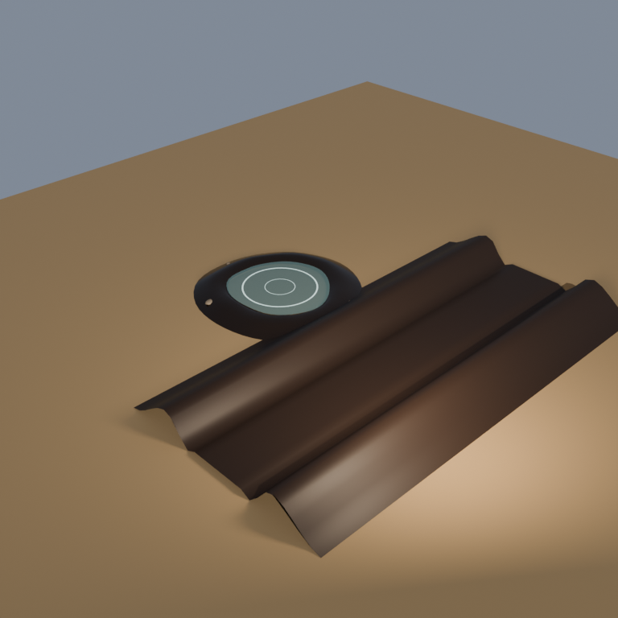

# Streams

Streams carry the music: mud flows from a burbler's mouth and pulses at its BPM, so a
stream is the played sequence laid out in space. The water is sheet music: a wavy
staff floats on it, and each beat's note rides the staff downstream at the water's
speed. As cleaning processes are identified the water goes from muddy to clear and
the staff glows brighter. Requirements: `openspec/changes/add-mudpit-burbler/`.

## Stream segment (`tools/blender/create_stream.py`)



A straight 4 m length of the burbler's own channel: 1 m of water between banked
sides, built up from the ground. Its bank profile and water height are imported from
`create_burbler.py`, so a segment meets the burbler's mouth exactly.

- **Chaining:** flow runs along +X; the origin is the inlet's centre on the ground.
  `Port_in` (x = 0) and `Port_out` (x = 4) each carry an upright halo arch
  (`Port_<end>_Halo`) for port highlighting while a stream is being extended. The ends
  are square and noise fades out toward them, so segments tile.
- **Bending:** 24 subdivisions along the length, for the game to bend it along a path.
- **Clarity:** one water material, `Stream_Water`, over a pebbled bed. `asset.json`
  lists its look at each of the four levels (`muddy` 0, `silty` 0.33, `cloudy` 0.67, `clear` 1;
  each working filter lifts the water one level: sRGB colour,
  roughness, alpha) for the game to blend. It ships muddy (alpha 0.98, so it exports
  alpha-blended). Each stage also sets the staff's glow (`staff_strength`, halo from silty).
- **Staff:** five luminous lines (`Staff`, material `Stream_Staff`) float just above
  the water at every clarity. Their centre waves sideways, y = 0.07 sin(2πx / 2 m), so
  a segment holds two whole waves and tiles.
- **Reeds:** a segment costs 6 reeds, and reeds outline both banks (`Reeds_L`,
  `Reeds_R`, pivots at the ground for a gentle sway), clear of the ends so joins do not
  double up. They go from dry to green with clarity (`reed_greenness` per stage).
- **Notes:** `Pulse_0` is a quarter note lying on the staff. The game spawns one per
  clock tick at the source and slides it downstream (+X) at `flow_speed_mps`, setting
  its y to the staff wave plus `staff_step` half-spaces for pitch. Notes sit
  `flow_speed_mps × 60 / BPM` apart, so velocity reads as spread (1 m at 90 BPM and
  1.5 m/s, as in the previews).

```sh
~/.local/bin/blender -b --factory-startup -P tools/blender/create_stream.py
```

## Stream hologram (`tools/blender/create_stream_hologram.py`)



The planned stream, shown while the player extends one: a luminous ghost of the
segment on the same 24 subdivisions, so the game bends and chains it the same way.
`Flow` chevrons scroll downstream (+X, wrapping every `spacing_m`); the game tints every
`StreamHologram_*` material by the profile's `states` (valid `#ffd39a`, invalid
`#ff5a46`). `previews/streams/stream_hologram/preview_extending.png` shows it running on from a laid stream.

```sh
~/.local/bin/blender -b --factory-startup -P tools/blender/create_stream_hologram.py
```

The game lays both (`crates/stubby_streams/src/lib.rs` and `dismantle.rs`,
`add-stream-building`): segment and hologram meshes are baked from these glTFs once and
bent along the plan. On a sounding stream, `Pulse_0` notes ride the staff on every beat
and `Bar_0` once per bar. A tuned reed water purifier lifts the water below it one
clarity stage (`stubby_game/src/purifier.rs` tints it from the profile's four stages:
muddy, silty, cloudy, clear). The staff's wave morph targets are not used yet: the bent
staff stays still.

Still to come: the conveyor-belt segments streams run along.

## Ripple pool (`tools/blender/create_stream_features.py`)

| Close | About 12 m |
| --- | --- |
|  |  |

A small still pool of clear water just beyond a laid stream's bank, where an oscilloscope
is found (`add-ripple-pool`). It is in the stream segment's frame (flow +X, origin at the
channel centre); a half turn puts it on the other bank. Pools form along every laid stream
at seeded Poisson-random places, one per 12 m on average (`stream_features` in
`assets/world/opening.json`), and go with their segment when it is dismantled.

- `Ripples` (extras `shown_while: beat`, shipped at scale 0): shown while the pool keeps
  its stream's clock, i.e. while the stream sounds; its `Ripple_Beat` clip (one beat) then
  plays on that clock, a ring leaving the centre on every beat.
- `Interact` (extras `resource: ripple_pool`): the collectable socket; the oscilloscope
  returns half a day after it is taken.
- No levels of detail: small and animated.

```sh
~/.local/bin/blender -b --factory-startup -P tools/blender/create_stream_features.py -- ripple_pool
```
