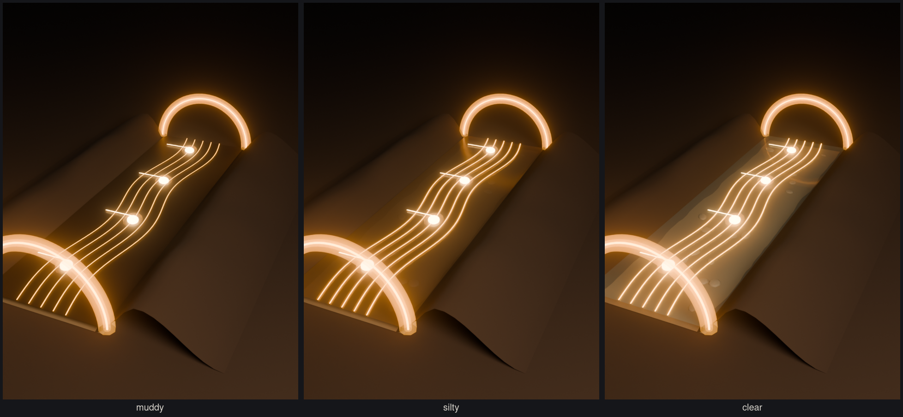
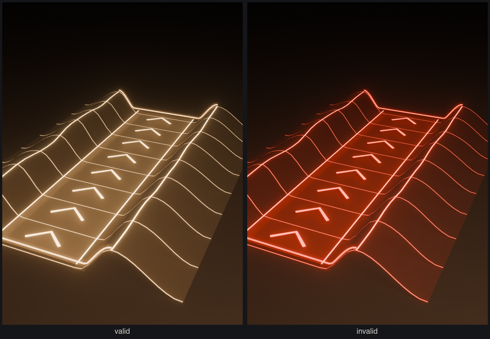

# Streams

Streams carry the music: mud flows from a burbler's mouth and pulses at its BPM, so a
stream is the played sequence laid out in space. The water is sheet music: a wavy
staff floats on it, and each beat's note rides the staff downstream at the water's
speed. As cleaning processes are identified the water goes from muddy to clear and
the staff glows brighter. Requirements: `openspec/changes/add-mudpit-burbler/`.

## Stream segment (`tools/blender/create_stream.py`)



A straight 4 m length of the burbler's own channel: 1 m of water between banked
sides, built up from the ground. Its bank profile and water height are imported from
`create_burbler.py`, so a segment meets the burbler's mouth exactly.

- **Chaining:** flow runs along +X; the origin is the inlet's centre on the ground.
  `Port_in` (x = 0) and `Port_out` (x = 4) each carry an upright halo arch
  (`Port_<end>_Halo`) for port highlighting while a stream is being extended. The ends
  are square and noise fades out toward them, so segments tile.
- **Bending:** 24 subdivisions along the length, for the game to bend it along a path.
- **Clarity:** one water material, `Stream_Water`, over a pebbled bed. `asset.json`
  lists its look at each stage (`muddy` 0, `silty` 0.5, `clear` 1: sRGB colour,
  roughness, alpha) for the game to blend. It ships muddy (alpha 0.98, so it exports
  alpha-blended). Each stage also sets the staff's glow (`staff_strength`, halo from silty).
- **Staff:** five luminous lines (`Staff`, material `Stream_Staff`) float just above
  the water at every clarity. Their centre waves sideways, y = 0.07 sin(2πx / 2 m), so
  a segment holds two whole waves and tiles.
- **Notes:** `Pulse_0` is a quarter note lying on the staff. The game spawns one per
  clock tick at the source and slides it downstream (+X) at `flow_speed_mps`, setting
  its y to the staff wave plus `staff_step` half-spaces for pitch. Notes sit
  `flow_speed_mps × 60 / BPM` apart, so velocity reads as spread (1 m at 90 BPM and
  1.5 m/s, as in the previews).

```sh
~/.local/bin/blender -b --factory-startup -P tools/blender/create_stream.py
```

## Stream hologram (`tools/blender/create_stream_hologram.py`)



The planned stream, shown while the player extends one: a luminous ghost of the
segment on the same 24 subdivisions, so the game bends and chains it the same way.
`Flow` chevrons scroll downstream (+X, wrapping every `spacing_m`); the game tints every
`StreamHologram_*` material by the profile's `states` (valid `#ffd39a`, invalid
`#ff5a46`). `preview_extending.png` shows it running on from a laid stream.

```sh
~/.local/bin/blender -b --factory-startup -P tools/blender/create_stream_hologram.py
```

Still to come: reeds, the conveyor-belt segments streams run along.
