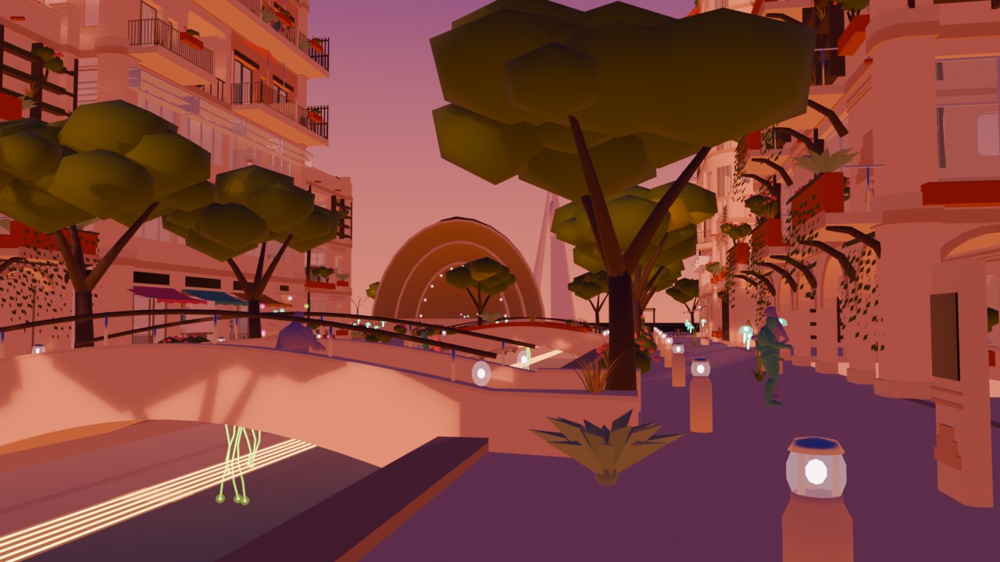

# City kit: regenerating, browsing, snapping

> **Residential expansion (2026-11-28):** 63 more pieces (priority `RES`) for shops, offices
> and homes, the mixed-use generator `tools/blender/city_mixed.py`, the validation bay
> (`tools/blender/create_city_mixed_bay.py`, scene `city_mixed_bay.bsn`) and a neighbourhood
> in the district (about 4,900 placements now). Brief and delta manifest:
> `docs/art/city-residential.md`. The commands below build them too.

The Phase 4 City's modular kit: **86 pieces** (P0 47, P1 26, P2 13), a reference district
built from them (2,356 placements of 76 pieces) and a modular test strip. Brief and rules:
`docs/art/city-kit.md`. Prompt: `docs/art/prompts/city-kit.md`.



## Regenerate

From the repository root, with Blender at `~/.local/bin/blender` (5.4 alpha used here):

```sh
# every piece, each in a clean Blender process (~40 s), then the index
blender -b --factory-startup -P tools/blender/create_city_kit.py
# one or more pieces
blender -b --factory-startup -P tools/blender/create_city_kit.py -- city_tree city_facade_window
# the index alone (no Blender): family asset.json, colliders.json, LOD metas, manifest, catalogs
python3 tools/blender/create_city_kit.py index
# validate every exported glb (materials' acoustic extras, transforms, normals/UVs, sockets, prefabs)
python3 tools/blender/check_city_kit.py
# per-piece previews and contact sheets (imports each glb, so it also proves they load)
blender -b --factory-startup -P tools/blender/render_city_previews.py
# the district: build the .blend, write the Jackdaw review scene, render the review views (~6 min)
blender -b --factory-startup -P tools/blender/create_city_district.py            # or -- norender
```

Then `python3 tools/check_asset_layout.py` and `python3 tools/jackdaw_lods.py --check`.

| Script | Does |
| --- | --- |
| `tools/blender/city_kit.py` | the contract: `Piece`, shared materials, primitives, relief motifs, glow, export |
| `tools/blender/city_build_p0.py` | P0: foundation, facades A and B, floor and roof, walks, circulation, canal, bridges, planting |
| `tools/blender/city_build_p1.py` | P1: terraces, light rail, gallery, concert hall, monument, luminous flora, staff |
| `tools/blender/city_build_p2.py` | P2: street furniture, infrastructure machines, growth overlays |
| `tools/blender/create_city_kit.py` | the runner and index |
| `tools/blender/check_city_kit.py` | glTF validation, results written into each profile's `validation` |
| `tools/blender/render_city_previews.py` | previews and sheets |
| `tools/blender/create_city_district.py` | the district, test strip, cameras, lighting presets, Jackdaw review scene |
| `tools/blender/city_build_res.py` | residential: retail, office, homes, balconies, dwelling shell, furniture, access, communal, proxies |
| `tools/blender/city_layout.py`, `city_mixed.py` | placement layouts; the mixed-use building generator and furnished homes |
| `tools/blender/create_city_mixed_bay.py` | the validation bay (build it before the district when the residential pieces change) |

## What it writes

| Where | What |
| --- | --- |
| `assets-src/blender/structures/city/<id>.blend` | each piece's editable source; its near level is a marked asset |
| `assets-src/blender/structures/city/city_district.blend` | scenes Day, Dusk, Night; collections District, Planting, Dancers, Test-Strip, Context, Blockout (hidden) |
| `assets-src/blender/structures/city/blender_assets.cats.txt` | asset catalogs (City/Facade, City/Canal, ...) |
| `assets/structures/city/<id>/` | `<id>.glb`, `<id>.bsn` (prefab), `asset.json` (profile), `<id>.glb.meta` (plants and the monument) |
| `assets/structures/city/asset.json`, `colliders.json` | the family index; collision proxies |
| `assets/world/asset_reviews/city.bsn` | the district as a Jackdaw review scene |
| `docs/art/city-kit/manifest.csv`, `manifest.json` | ID, files, size, origin, connectors, sockets, materials and acoustics, triangles, phases, licence, validation |
| `docs/art/city-kit/district_layout.json` | every placement in the district and test strip |
| `previews/structures/city/` | `sheet_1..4.png` (every piece), `district_<camera>_<light>.jpg` |

## The asset browser

Add `assets-src/blender/structures/city/` as an asset library (Preferences, File Paths, Asset
Libraries). Each piece's file holds one marked collection named after the piece (its near
level and sockets), filed under the City catalogs. Drag it in as a **linked** collection
instance, which is how `create_city_district.py` builds the district, and never append it.
Regenerating a piece updates every district that links it.

## Snapping

- Turn on increment snapping at **1 m** (detail at 0.25 m). Bays are 4 m and storeys 4 m.
- **Linear pieces** (facades, slabs, walks, parapets, banks, paving, kerbs, rails, staff,
  pipes) snap by their origin at the left front corner. The next piece in a run goes 4 m (or
  8 m) along +X. To turn a run around, rotate 180° and put the origin at the far end.
- **Facades** sit on the footprint line with their wall inside it. Close every outside
  corner with `city_facade_corner` and every free end with `city_facade_end`, and the same
  at the roof with `city_parapet_corner`.
- **Storeys** stack at z = 4 k. The floor band at 3.7 to 4.0 m is shared by both facade
  variants. A ground-floor arcade is `city_facade_arcade` at the street line, with doors and
  windows 4 m behind it and a `city_slab_4` at z 3.98 over the gap.
- **Canal**: banks along the water's edge, water tiles on the water side (+Y), the far bank
  turned 180°. The bridge's origin is the near wall face's line, and it spans 8 m.
- **Standalone pieces** snap by the centre of their base. Plants go at the sockets whose
  `accepts` they fit (`small`, `shrub`, `tree`, `vine`, `reeds`).
- Every connector, socket and offset is listed in `manifest.json`.

## Reviewing in the game

```sh
python3 tools/jackdaw_timed_test.py --standalone --asset-review city --name city
```

The scene stands the district 2.3 m up, because the game's ground has no cut for the canal.

## Measured

Triangle counts are near level (far level), from the profiles. The budgets are the prompt's.

| Piece | Triangles | Budget |
| --- | --- | --- |
| props (bench, bollard, sign, pedestal) | 140 to 384 | 100 to 1,500 |
| facade bays | 156 to 444 | 500 to 3,000 (under: flat PBR, no trim detail) |
| tree | 604 (80) | 1,000 to 5,000 (under) |
| footbridge | 2,224 (planted: 2,624) | 2,000 to 8,000 |
| hall shell, monument | 2,264; 1,100 (60) | 10,000 to 30,000 (well under) |
| glow tendril, motes | 2,168; 1,872 | mostly halo shells: the overdraw to watch |

The whole kit is 35,312 near-level triangles across 86 pieces. No textures: every material
is a flat PBR colour, with 1 to 9 material slots per piece. FPS has not been measured.

## Known limitations

- **Scenery, not placeables.** City pieces are not bridged to `PlacedAsset` (it stalled
  the district's first frame past 20 s). Acoustics reach Steam Audio through node extras;
  walls are solid via `crates/stubby_jackdaw/src/city_colliders.rs`; decks, bridges and
  stairs are not walkable yet (`add-prefab-colliders`).
- **The whole district is over frame budget**: about 82,000 entities at 30-35 fps with dips
  (one building holds 60). See `add-city-kit` task 5.5.
- **No canal cut in the ground** (see *Reviewing in the game*).
- **Interiors are empty** behind the translucent glass.
- **Stair landings float**: a landing at storey height sits on a 2 m pier, open beneath it.
- **The arcade's ceiling slab** is dropped 2 cm (z 3.98) to avoid a coplanar band. Snap it there.
- **Canal bends are right angles** with a rounded convex corner. There is no curved canal.
  The rail curve (22.5°, R 20 m) is the only curved module and does not land on the 4 m grid.
- **LOD sizes** in the `.meta` files are each model's largest extent, as Jackdaw's import
  measures it. Re-run Jackdaw's *Import LOD levels* and *Apply* to confirm, then
  `jackdaw_lods.py --switch`.
- **Preview glow** comes from a compositor glare. The game's bloom is separate and has not
  been reviewed in game.
