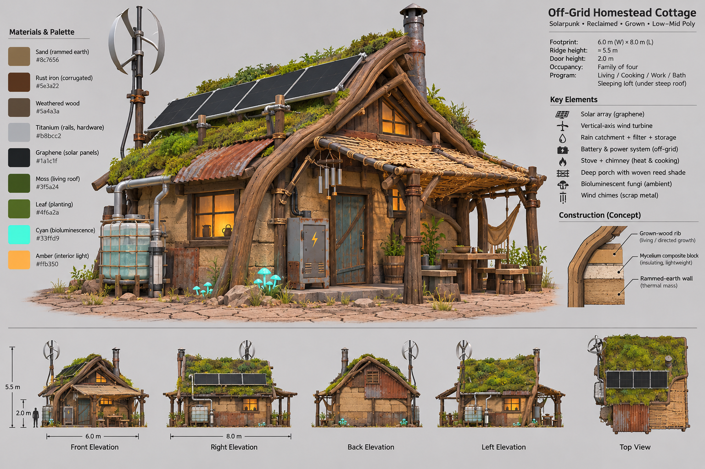

# Cottage art direction

**Draft (2026-11-20).** The first Dancer dwelling: an off-grid homesteader cottage for a
family of four (`add-settlement-economy`: a cottage houses at most four). It appears in
Village, the first building Dancers live in. Prompt: [prompts/cottage.md](prompts/cottage.md).
Images are in `docs/art/cottage/`; where they disagree with these rules, the rules win.

## Concept (2026-11-20)

**The hero view is adopted** (user: "not bad"). Its dimensions match the brief (6 × 8 m,
5.5 m ridge, 2 m door). The elevations beneath it drift from the hero and from each other,
so model from the hero and these rules:

- **Massing:** a gable roof running front to back; one great grown-wood rib sweeps from the
  ridge down past the front-left corner to the ground, the signature of the silhouette;
  the porch, with its reed-mat shade, runs along the right side.
- **Placement, one of each:** the rain tank (an IBC-style cage tote) at the front-left
  corner; the battery cabinet left of the door; the turbine mast at the rear-left corner;
  the chimney at the rear-right of the ridge; the solar row on the left roof slope; the
  corrugated patch at the front-left eave and lower left wall. The sheet's right and left
  elevations both show a tank, and the turbine wanders; keep the hero's.
- **Front:** one door, a ground-floor window left of it, a gable window above; the wind
  chimes hang under the front eave between them.
- **Not part of the cottage model:** the table, stools, barrels, buckets, pots, hammock and
  loose rocks. They make a small homestead prop kit placed beside it, so the cottage stays
  one clean glb and its porch can be dressed or left bare.

## Continuity rules

- **Size:** one storey plus a sleeping loft under a steep roof; about 6 × 8 m, ridge about
  5.5 m; a 2 m door. The player's eye is 1.65 m, so the eaves sit just above it.
- **Crude carries the weight:** rammed earth and mycelium-composite walls, salvaged timber
  framing, rusted corrugated patches. The roof's grown-wood ribs are structural and flow
  into the corner posts, as the vardo's grown roof does (`vardo-and-cyber-cob.md`).
- **High-tech does the precise work:** graphene solar panels on titanium rails, a
  vertical-axis wind turbine, a rain tank with a filter column, a battery cabinet. Every
  piece is strapped to the crude structure with a visible join.
- **A living roof:** sod, moss and short grasses; it should read green as the world
  blooms. One corrugated panel keeps the scrap story.
- **Light:** soft fungi glow at the wall base (cyan, bloomed accent) and one warm window
  (amber). No LED strips. Emissive parts are separate materials so the game can light the
  window at night.
- **Music:** wind chimes under the eaves; a candidate for a voice in the local mix.
- **Consistent across views:** one door, on the porch side; the solar row on the
  sun-facing roof slope; the turbine mast and the rain tank on the same corners in every
  view.

## For the model

- One glb with model-owned LODs (`<id>_LOD0`, ...) and a master prefab, as every placeable.
- Sockets to plan: `Interact` at the door; a `Window` emissive material; the chimney top for
  smoke later.
- Acoustics: earth walls are a sound-critical surface; mark them `AcousticOccluder` per
  `docs/audio/acoustic-level-authoring.md`.
- Variants: a later larger dwelling (more Dancers) should share this kit.

## Checklist

- [ ] Reads as a cottage, not a cabin cliché or a suburban house, at 12 m in haze
- [ ] Every high-tech part has a visible join to a crude part
- [ ] Views agree: door side, window count, solar slope, turbine and tank corners
- [ ] Palette from the style guide; light restrained and organic
