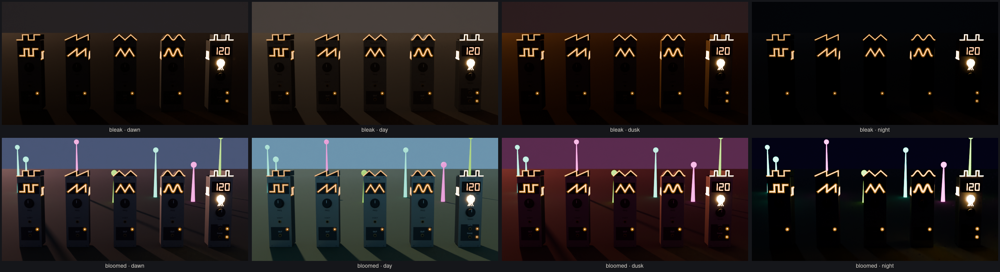
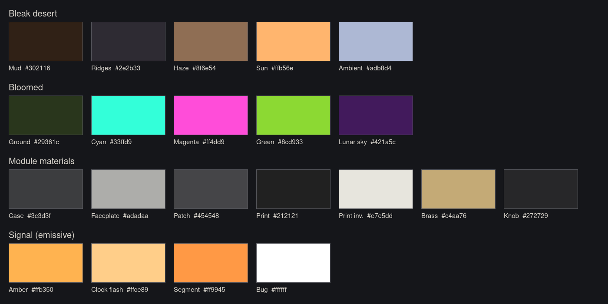

# Art style guide

A living document. The style is still moving; change this file when it does, and add
a line to the changelog at the bottom. Art (Claude) owns this guide, the Blender
generators and the lighting keys. Game logic (Codex) owns the code that reads them.



*`style_sheet.png`: the module lineup under each lighting key. Rows are light quality
0 (bleak) and 1 (bloomed); columns are dawn, day, dusk and night. The coloured stalks
are stand-ins for bloomed flora until it exists. Regenerate with
`blender -b --factory-startup -P tools/blender/render_style_sheet.py`.*

## Theme

**The music of nature brings light to the world.** The player grows plants and
animals by singing or playing music to them, and life brings the light back. Every
art decision serves that causal chain, which the player should be able to *see*:

> music played → carried by streams → life grows → light quality rises → the world blooms

**Streams are staff music.** They deliver music to plants and animals as nutrients.
They begin as **mud** flowing from a burbler (a gurgling hot-spring mud pot that
bubbles at a BPM) and **pulse at that BPM**, so a stream is the played sequence laid
out in space. Raw streams are **muddy on purpose**, like ore. As other processes are
identified, constructors clean them, and the water goes **from muddy to clear** in
stages. The water is always sheet music: a wavy five-line staff floats on it and
each beat's note rides the staff downstream at the water's speed, so note spacing shows
velocity; it glows brighter and crisper as the water clears. Stream assets need a look for each stage. Reeds build streams: 6 reeds make a segment, and reeds outline its banks, dry while muddy and green as it clears. They are as easy to gather as leaves in Satisfactory. Ports light a soft
halo arch while a stream is being extended from them (Satisfactory's port
highlighting), and the planned stream shows as a hologram before it is laid.

So growth reads as a response to sound: flora and fauna that are being played to
should visibly react (sway, pulse, open, glow in time) before they bloom. Bloom
spreads outward from where the music is, not uniformly across the map.

## Pillars

1. **Satisfactory meets Inside.** Industrial objects you can read at a glance, set in
   fog, silhouette and quiet dread.
2. **Bleak where nothing grows; magically colourful where life returns.** The
   opening is a hazy, desaturated, brown-grey mudflat. Where music has grown plants
   and animals the world blooms: **solarpunk** by day (clear air, teal sky, saturated
   greens) and **lunarpunk** by night (violet sky, luminous cyan, magenta and green
   flora).
3. **The signal is the constant.** Module light is always the same amber, in every
   key. Everything else in the world changes around it. If a module's amber stops
   reading against a key, fix the key, not the module.
4. **Sound you can see.** A module's waveform is legible from a distance, and its
   lights move with what the engine is actually doing. Nothing flashes on its own
   timer.

## Lighting: two axes

| Axis | Scope | Range | Drives |
| ---- | ----- | ----- | ------ |
| Time of day | global | dawn → day → dusk → night → dawn | sun, ambient, sky, fog, exposure |
| **Light quality** | local, per 10 m cubic cell | 0 bleak … 1 bloomed | blends the bleak and bloomed keys |

Light quality follows game conditions, mostly the density of plants and animals the player's music has grown. The global lights use
the value sampled at the camera. Per-cell values tint what you look *at*: ground and
flora emission. A grove at light quality 1 therefore shows its colour from the bleak
plain outside it, and becomes the lighting once you walk in.

All values live in [`assets/lighting/lighting_keys.json`](../../assets/lighting/lighting_keys.json)
as eight keys (2 moods × 4 times), in sRGB, with physical-ish lux for Bevy. Art tunes
that file; the game hot-reloads it. When you change it, bump `version`, re-render the
style sheet and look at all eight tiles.

Reading the keys:

- **Haze is the bleak desert's identity.** Bleak fog density is 0.006–0.008; bloomed
  is 0.0008–0.002. Clearing the air is most of what "blooming" means.
- **Night is dark but never black.** Silhouettes must hold against the horizon. Bleak
  night is lit by a dull moon; lunarpunk night by a bright violet sky and the flora.
- **`emissive_gain` rises at night and when bloomed.** Lights read stronger as the
  world darkens, and the bloomed world glows on purpose.

## Palette



Hex values are sRGB, which is what game code and the keys file use. **Blender
material colours are linear**: `module_kit.AMBER = (1.0, 0.45, 0.08)` is sRGB
`#ffb350`. Convert when moving a colour between the two. This mistake has already
been made once (2026-10-31, `accents[0]`).

| Group | Colours |
| ----- | ------- |
| Bleak desert | Mud `#302116`, Ridges `#2e2b33`, Haze `#8f6e54`, Sun `#ffb56e`, Ambient `#adb8d4` |
| Bloomed | Ground `#29361c`, accents Cyan `#33ffd9`, Magenta `#ff4dd9`, Green `#8cd933`, lunar sky `#421a5c` |
| Module materials | Case `#3c3d3f`, Faceplate `#adadaa`, Patch `#454548`, Print `#212121`, Print inverted `#e7e5dd`, Brass `#c4aa76`, Knob `#272729` |
| Signal (emissive) | Amber `#ffb350`, Clock flash `#ffce89`, Segment `#ff9945`, Bug `#ffffff` |
| Crude | Sand `#8c7656`, Rust iron `#5e3a22`, Weathered wood `#5a4a3a` |
| High-tech | Titanium `#b8bcc2`, Graphene `#1a1c1f` |
| Scrub oak | Bark dormant `#625d57`, alive `#4b4037`, Leaf young `#7b8c3c`, mature `#36412a`, Dry leaf `#7a5a3a`, Bud `#9a6a48`, Catkin `#c8f060` |
| Reeds | Stalk dry `#9a8460`, green `#5f6e34`, Blade dry `#8a7552`, green `#4f5e2c`, Cattail `#4a3222`, Cut `#c2ab7c` |
| Desert props | Twig `#7d7468` → `#4f4234`, Stump `#8f897d` → `#4f4134`, Heartwood `#8a7a62`, Mud plate `#5a4433` → `#3e2f22`; bloomed Leaf `#4f6a2a`, Moss `#3f5a24`, Sprout `#6f9a34`, Mushroom stem `#d9d2c0`; luminous flowers Magenta, mushrooms Cyan |
| Patch cables | Rust `#9c3b2a`, Ochre `#b8892f`, Verdigris `#3f7a6e`, Slate `#4b5a78`, Bone `#cfc6b2` (not emissive) |
| Build (holograms) | Valid `#ffd39a`, Invalid `#ff5a46` |

The accents belong to flora and the bloomed world. Keep them off modules: amber is
the only signal colour. Build holograms are pale amber, kin to the port arches they snap
to, and turn red where a plan cannot be laid.

## Scale

- Metres, +Y up in the game (+Z up in Blender; the exporter converts).
- Modules are Eurorack at ×10: 3U is 1.285 m tall, 1 HP is 0.0508 m, and most modules
  are 8 HP wide. The faceplate faces glTF +Z, with the origin at the base centre.
- The player's eye is at 1.65 m, so a module's crown sits just below eye level and
  its glyph is read slightly from above.

## Legibility at three distances

Every module states what it is three times. Check all three in its previews.

| Distance | Feature | Must read as |
| -------- | ------- | ------------ |
| Far (12 m and beyond, in haze) | **Crown**: the waveform's silhouette cut along the top edge | the waveform's shape against the sky |
| Mid (3–12 m) | **Faceplate glyph**: a large emissive trace set in a recess | the waveform, from straight on |
| Side and oblique | **Side glyphs** on both cheeks, mirrored on the left | the waveform, from beside it |

`preview_far.png` (12 m) is the test. If the shape is not obvious there, it is not
done.

## Materials: crude meets high-tech

Machines are built from **very crude materials joined to very high-tech ones**, as if
salvage and cutting-edge parts were lashed together by someone making do. Every
machine uses both registers, and the join should show: a titanium rail strapped to a
rough wooden post with rusted iron, a graphene plate sitting on sandbags.

| Crude | Look | High-tech | Look |
| ----- | ---- | --------- | ---- |
| Sand (sandbags, packed earth) | matte, warm grey-tan | Titanium | cool, pale grey, satin metal |
| Iron | rusted, rough, dark brown-orange | Graphene | near-black, glassy, faint sheen |
| Wood | weathered, grey-brown, rough-hewn | | |

Crude parts carry the weight (posts, footings, straps); high-tech parts do the
precise work (rails, probes, panels). Luminescent accents sit on top of both.

## Luminescence: jellyfish and fairies, not LEDs

Living light in this world is **soft, organic and alive**: jellyfish, fairies,
plankton in a wave. It is never a hard point or a crisp rectangle.

- **Soft edges.** A bright core inside a larger, faint, translucent halo shell. Glow
  falls off; it does not stop at an edge.
- **Organic shapes.** Bells, teardrops, threads, veins, drifting motes. Not discs,
  squares or segments.
- **It breathes.** Light swells and fades with an envelope (the module profiles'
  rest and peak), and it drifts: wisps rise, motes wander.
- **Colour.** Signal light stays amber, but warm and fairy-like rather than LED
  orange. Bloomed flora and creatures use the accent palette.
- **In glTF:** emissive plus alpha blending (a bright opaque core inside
  `alpha` 0.2–0.4 shells). No Blender-only glow tricks; the game's bloom does the
  rest.

The first modules (VCOs, clock) predate this rule: their LEDs and segment display are
LED-like. Read them as legacy; they migrate as they are touched (`add-art-direction`
2.8). The clock display may stay segmented, because a number has to be read.

## Material rules

- glTF metallic-roughness only. No Blender-only nodes, no procedural textures that do
  not export.
- **Emissive materials are authored at peak.** The profile (`asset.json`) records the
  rest and peak levels; the game drives the value between them. Never bake a "half
  lit" state into the model.
- Lights that the game animates are separate materials (`Glyph`, `LedOut`,
  `Clock_Lamp`, …). The game clones them per instance, so name them stably.
- Colour lives in materials, not textures, until a texture earns its place.

## Naming and game-facing nodes

Generated objects follow the module kit's names; the game finds parts by these empties
and their glTF extras:

| Node | Meaning |
| ---- | ------- |
| `Port_<port>` | a jack; extras give the direction |
| `Knob_<param>` | a knob bound to an engine parameter; extras give range, taper and rotation |
| `Light_<light>` | an LED |
| `Lamp` | a module's main lamp (the clock's flash) |
| `Display`, `Display_d<n>_<seg>` | a seven-segment display and its segments |

Files, grouped by category folder (`creatures`, `flora/<family>`, `machines`, `modules`,
`props/<family>`, `streams`), the same folder in each tree:
`assets-src/blender/<folder>/<id>.blend`, `assets/models/<folder>/<id>.glb` (with any
`<id>_LOD1.glb` beside it), and `assets/<folder>/<id>/{asset.json,preview.png,preview_far.png}`.
Ids are `snake_case`.

## Pipeline

Generator scripts are the source of truth, never hand edits to a `.blend`:

```bash
blender -b --factory-startup -P tools/blender/create_vco.py -- square
blender -b --factory-startup -P tools/blender/create_clock_lamp.py
blender -b --factory-startup -P tools/blender/render_style_sheet.py
```

Each generator builds an isolated scene, so it is safe to run through the Blender MCP
too. `tools/blender/module_kit.py` holds the shared module parts, and
`tools/blender/export_gltf.py` does the export. After changing a module, run the game's
asset test: `cargo test -p stubby_game --test module_assets`.

## Budgets

Current models, for scale: VCOs 4.6k–7.8k triangles, the clock 6.7k, the lightning bug
364, the mudpit burbler 14.9k (the rig concept 14.7k), the burbler clock
9.9k, the volume module 6.1k, the patch plug 1.1k, the stream segment 12.0k with its reed outline, the stream hologram 5.4k, the reed clump 1.4k–1.7k, desert props 0.2k–4.4k, the scrub oak 11.0k–14.7k (far LOD ≤ 1.1k). Nested halo shells are the
expensive part of soft light; keep their resolution as low as still reads round.

| Asset | Triangles | Materials |
| ----- | --------- | --------- |
| Module | ≤ 10k | ≤ 16 |
| Creature | ≤ 2k | ≤ 4 |
| Prop, tree | ≤ 15k, with a ≤ 3k far LOD | ≤ 8 |

## Review checklist

Before an asset ships:

- [ ] Generated by a script in `tools/blender/`; re-running it reproduces the asset.
- [ ] Reads at all three distances (`preview.png`, `preview_far.png`).
- [ ] Reads in every tile of the style sheet, especially bleak dusk and both nights.
- [ ] Emissive authored at peak; rest and peak in the profile.
- [ ] Game-facing nodes named per the table above; `module_assets` test passes.
- [ ] Within budget.
- [ ] Colours from the palette; any new colour added here.

## Changelog

- **2026-10-31** — Configuration racks are built from shared parts: a rack frame that
  stretches to any width, slot outlines in the build-ghost amber for 4–16 HP, and a
  label per component kind (CLOCK, VCO, VCF, VCA) with a glyph. Empty slots show what
  goes there; the mocks now render the burbler's construction and built states.
- **2026-10-31** — Patch cable: a general plug (titanium sleeve, knurled graphene grip,
  coloured collar) and a fully elastic VCV Rack-style cable the game draws. The burbler
  clock gains a BPM knob and the volume module a TRIG jack; the HUD mock shows the
  voice patched with two cables. Cable colours added to the palette.
- **2026-10-31** — Desert props for the opening, each blooming on light quality: dead
  brush (leafs out, magenta flowers), bleached stumps (damp wood, moss, cyan mushrooms)
  and curled mud-plate debris (sprouts). Three seeded variants each; blooms open
  gradually, node by node.
- **2026-10-31** — Reeds outline the stream segment's banks (6 reeds build a segment):
  dry while the water is muddy, green as it clears.
- **2026-10-31** — Reeds: a frequent renewable. Clumps of tall reeds with cattail heads,
  four seeded variants plus per-instance variation; harvested they show cut stubble with
  pale cut faces, and they grow back. Dry to green on one value. Reed colours added.
- **2026-10-31** — Scrub oak: six seeded variants of a many-stemmed desert oak, varied
  again per instance in the game. It starts dormant in winter (grey wood, buds, dry
  leaves holding on) and one growth value, raised by clean water, takes it through
  budding and leaf-out to full bloom with hanging luminous catkins, where its bugs
  come from. Flora colours added to the palette.
- **2026-10-31** — Streams are sheet music at every stage: the staff floats on the
  surface and waves from bank to bank (two waves per 4 m segment, so it tiles), and
  each beat's note rides it downstream at the flow speed. Replaces the staff hidden
  under muddy water and the band-of-light pulse.
- **2026-10-31** — Stream hologram: the planned-stream preview, a luminous ghost of
  the stream segment on the same 24 subdivisions so it bends and chains like the stream
  it plans. Faint shells, crest and edge lines, half-metre ribs and downstream chevrons;
  pale amber when valid, red when not. Build colours added to the palette.
- **2026-10-31** — Stream segment: the burbler's 1 m banked channel as a tileable
  4 m piece. Muddy water hides five luminous staff lines on its bed; as it clears they
  show through and the beat's pulse turns from a band of light into a note on the staff.
- **2026-10-31** — First modules in the newer language: the burbler clock and volume
  HUD modules (wood case, iron hardware, titanium faceplate, jellyfish-bell lamp, soft
  lights), and a mock of the configuration HUD (`hud_mock.png`). Unlit display segments
  are dark and matte so they never read as lit.
- **2026-10-31** — The burbler is an organically round pool with a 1 m banked stream
  leaving it, framed as a tall preview looking up the stream. Bubbles carry baked
  one-beat clips. Stream water goes from muddy to clear as processes are identified.
- **2026-10-31** — The burbler is the head of a mud stream: a channel about 1 m wide
  between banked sides, framed as a tall (portrait) preview looking up the stream. Its
  port is an upright halo arch over the mouth, lit while a stream is extended from it.
- **2026-10-31** — The burbler is a natural hot-spring mud pot (no in-world rack);
  configuring it opens a Eurorack HUD. Mud streams leave it through an outlet that
  halos when connected; raw mud stays muddy. The rack version is kept as a concept,
  `mudpit_burbler_rig`.
- **2026-10-31** — Mudpit burbler (clock mine). Materials blend crude (sand, iron,
  wood) with high-tech (titanium, graphene); luminescence is jellyfish- and
  fairy-like, not LED. Existing module LEDs marked legacy.
- **2026-10-31** — First version. Lighting keys for 2 moods × 4 times; style sheet
  render; palette. The bleak-to-bloomed blend is **light quality**, a local field of
  10 m cells driven mostly by plant and animal density, replacing the earlier single
  global Mood. Theme recorded: the music of nature brings light to the world; streams are staff
  music carrying musical nutrients.
  Night keys re-exposed so silhouettes hold. Fixed `accents[0]`, which had been
  copied from Blender's linear amber into the sRGB keys file.
