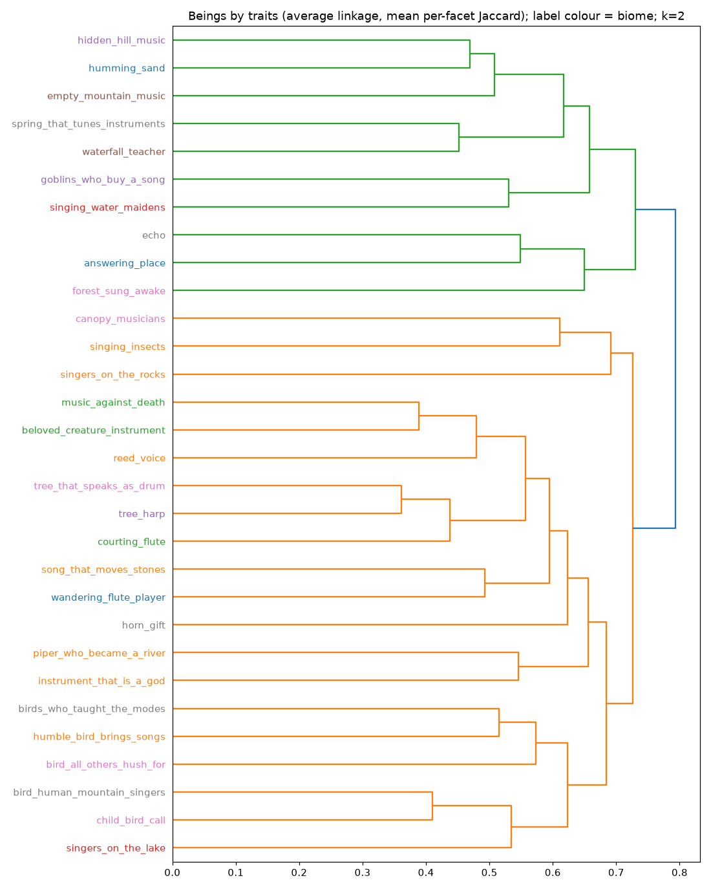
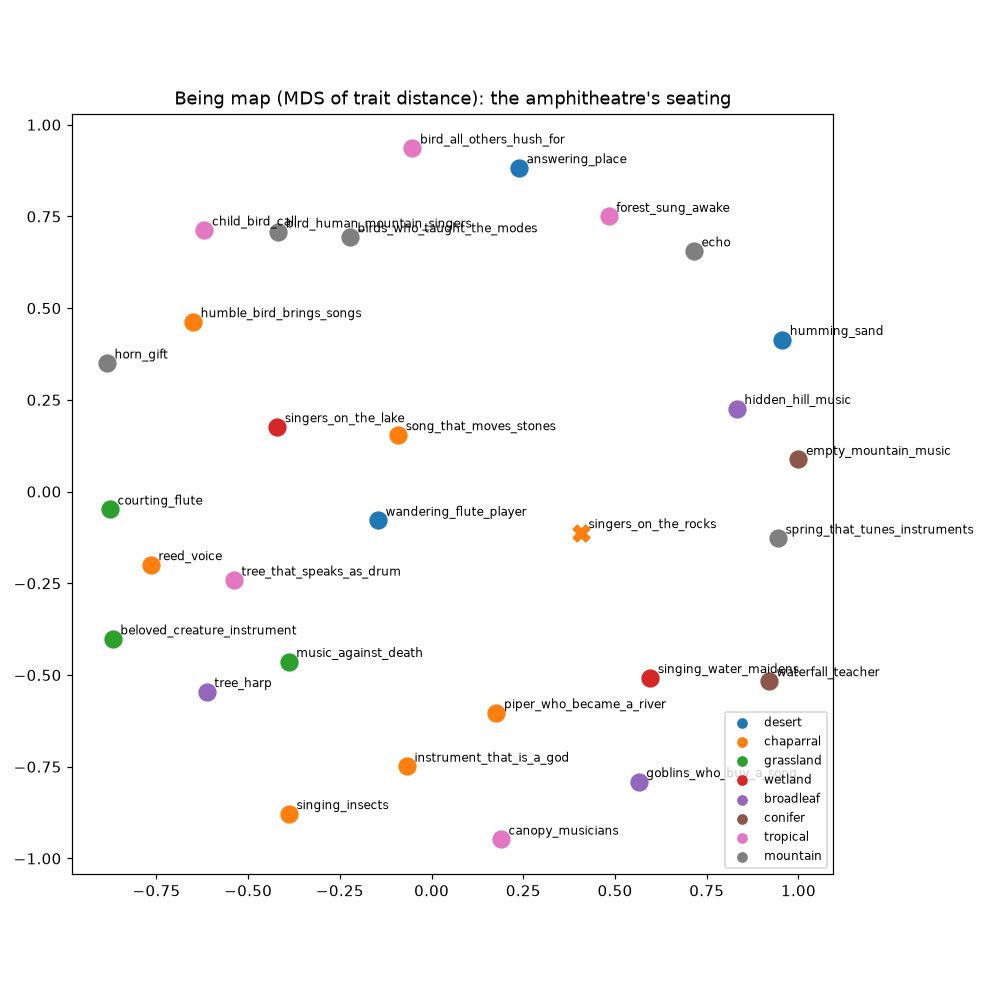

# Being atlas: cluster report (music=core)

Generated by `uv run tools/beings/cluster.py` from `beings.json`; do not edit.

30 beings ({'spirit': 20, 'creature': 9, 'monster': 1}). Distance: mean over facets of the Jaccard distance between trait sets. Clustering: average linkage, k chosen by silhouette. Biome is not an input.

- **k = 2** (silhouette 0.16; tried 2: 0.16, 3: 0.13, 4: 0.11, 5: 0.09, 6: 0.10, 7: 0.10, 8: 0.10, 9: 0.10, 10: 0.08)
- **Agreement with biome** (adjusted Rand index, primary biome): **0.08** (1 = clusters are exactly the biomes, 0 = no better than chance)
- **Cut into 8 clusters**, as many as biomes: adjusted Rand index **-0.00**
- **Nearest neighbour shares a biome**: **17%** of beings, against **20%** by chance

## Clusters

### Cluster 1 (20)

- `wandering_flute_player` (desert), `reed_voice` (chaparral), `singing_insects` (chaparral), `beloved_creature_instrument` (grassland), `music_against_death` (grassland), `courting_flute` (grassland), `singers_on_the_lake` (wetland), `tree_harp` (broadleaf), `child_bird_call` (tropical), `canopy_musicians` (tropical), `horn_gift` (mountain), `singers_on_the_rocks` (chaparral), `song_that_moves_stones` (chaparral), `instrument_that_is_a_god` (chaparral), `humble_bird_brings_songs` (chaparral), `piper_who_became_a_river` (chaparral), `bird_all_others_hush_for` (tropical), `tree_that_speaks_as_drum` (tropical), `birds_who_taught_the_modes` (mountain), `bird_human_mountain_singers` (mountain)
- shared traits: `music:core`, `presence:seen`, `disposition:benevolent`, `time:any`, `role:performer`

### Cluster 2 (10)

- `humming_sand` (desert), `answering_place` (desert), `hidden_hill_music` (broadleaf), `waterfall_teacher` (conifer), `empty_mountain_music` (conifer), `echo` (mountain), `singing_water_maidens` (wetland), `goblins_who_buy_a_song` (broadleaf), `forest_sung_awake` (tropical), `spring_that_tunes_instruments` (mountain)
- shared traits: `music:core`, `time:night`, `disposition:ambivalent`, `form:unseen`, `presence:heard_only`, `sound:voice`

## Clusters × biomes

| biome | c1 | c2 |
| --- | --- | --- |
| desert | 1 | 2 |
| chaparral | 7 | 0 |
| grassland | 3 | 0 |
| wetland | 1 | 1 |
| broadleaf | 1 | 2 |
| conifer | 0 | 2 |
| tropical | 4 | 1 |
| mountain | 3 | 2 |

## Biome signatures

Traits most over-represented in each biome (share in biome minus share overall).

- **desert** (5): `role:giver`, `place:rock`, `form:unseen`, `theme:rain`, `place:sand`, `element:sand`
- **chaparral** (8): `presence:seen`, `theme:death`, `time:any`, `place:cave`, `theme:longing`, `place:rock`
- **grassland** (3): `place:open_grass`, `gift:instrument`, `transformation:creature_to_instrument`, `form:animal`, `role:maker`, `theme:love`
- **wetland** (4): `element:water`, `place:lake`, `presence:seen`, `role:maker`, `element:plant`, `theme:love`
- **broadleaf** (5): `place:grove`, `sound:laugh`, `place:hill`, `time:night`, `sound:strings`, `place:tree`
- **conifer** (3): `place:grove`, `time:night`, `sound:strings`, `element:wood`, `disposition:ambivalent`, `theme:trickery`
- **tropical** (5): `place:canopy`, `element:wood`, `place:tree`, `transformation:human_to_animal`, `sound:birdsong`, `time:day`
- **mountain** (6): `place:peak`, `place:cliff`, `theme:bargain`, `sound:voice`, `role:giver`, `theme:joy`

## Nearest neighbour

| being | nearest | distance | same biome |
| --- | --- | --- | --- |
| `humming_sand` | `hidden_hill_music` | 0.47 | no |
| `answering_place` | `echo` | 0.55 | no |
| `wandering_flute_player` | `song_that_moves_stones` | 0.49 | no |
| `reed_voice` | `music_against_death` | 0.47 | no |
| `singing_insects` | `canopy_musicians` | 0.61 | no |
| `beloved_creature_instrument` | `music_against_death` | 0.39 | yes |
| `music_against_death` | `beloved_creature_instrument` | 0.39 | yes |
| `courting_flute` | `tree_that_speaks_as_drum` | 0.41 | no |
| `singers_on_the_lake` | `child_bird_call` | 0.51 | no |
| `tree_harp` | `tree_that_speaks_as_drum` | 0.36 | no |
| `hidden_hill_music` | `spring_that_tunes_instruments` | 0.46 | no |
| `waterfall_teacher` | `spring_that_tunes_instruments` | 0.45 | no |
| `empty_mountain_music` | `humming_sand` | 0.47 | no |
| `child_bird_call` | `bird_human_mountain_singers` | 0.41 | no |
| `canopy_musicians` | `instrument_that_is_a_god` | 0.58 | no |
| `echo` | `answering_place` | 0.55 | no |
| `horn_gift` | `music_against_death` | 0.56 | no |
| `singers_on_the_rocks` | `birds_who_taught_the_modes` | 0.58 | no |
| `song_that_moves_stones` | `wandering_flute_player` | 0.49 | no |
| `instrument_that_is_a_god` | `music_against_death` | 0.54 | no |
| `humble_bird_brings_songs` | `birds_who_taught_the_modes` | 0.52 | no |
| `piper_who_became_a_river` | `instrument_that_is_a_god` | 0.55 | yes |
| `singing_water_maidens` | `goblins_who_buy_a_song` | 0.53 | yes |
| `goblins_who_buy_a_song` | `singing_water_maidens` | 0.53 | yes |
| `bird_all_others_hush_for` | `birds_who_taught_the_modes` | 0.55 | no |
| `tree_that_speaks_as_drum` | `tree_harp` | 0.36 | no |
| `forest_sung_awake` | `answering_place` | 0.59 | no |
| `spring_that_tunes_instruments` | `waterfall_teacher` | 0.45 | no |
| `birds_who_taught_the_modes` | `humble_bird_brings_songs` | 0.52 | no |
| `bird_human_mountain_singers` | `child_bird_call` | 0.41 | no |
