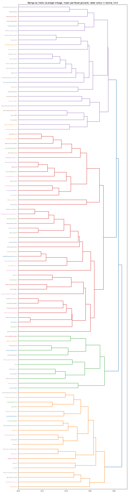
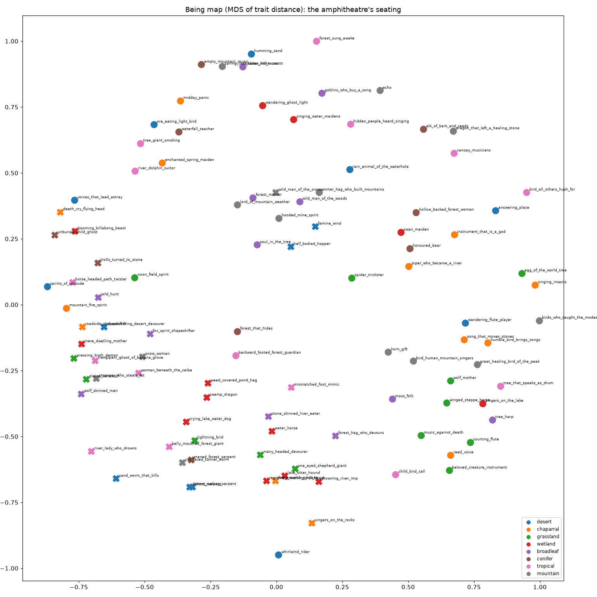

# Being atlas: cluster report (without music, without sound, without place, without element)

Generated by `uv run tools/beings/cluster.py` from `beings.json`; do not edit.

103 beings ({'spirit': 41, 'creature': 20, 'monster': 42}). Distance: mean over facets of the Jaccard distance between trait sets. Clustering: average linkage, k chosen by silhouette. Biome is not an input.

- **k = 4** (silhouette 0.18; tried 2: 0.15, 3: 0.14, 4: 0.18, 5: 0.15, 6: 0.15, 7: 0.15, 8: 0.15, 9: 0.17, 10: 0.18, 11: 0.17, 12: 0.17, 13: 0.16, 14: 0.18, 15: 0.18, 16: 0.18, 17: 0.18, 18: 0.17, 19: 0.16, 20: 0.16, 21: 0.15, 22: 0.15, 23: 0.16, 24: 0.15)
- **Agreement with biome** (adjusted Rand index, primary biome): **0.01** (1 = clusters are exactly the biomes, 0 = no better than chance)
- **Cut into 8 clusters**, as many as biomes: adjusted Rand index **0.01**
- **Nearest neighbour shares a biome**: **19%** of beings, against **20%** by chance

## Clusters

### Cluster 1 (21)

- `wandering_flute_player` (desert), `reed_voice` (chaparral), `singing_insects` (chaparral), `beloved_creature_instrument` (grassland), `music_against_death` (grassland), `courting_flute` (grassland), `singers_on_the_lake` (wetland), `tree_harp` (broadleaf), `child_bird_call` (tropical), `horn_gift` (mountain), `song_that_moves_stones` (chaparral), `humble_bird_brings_songs` (chaparral), `wolf_mother` (grassland), `winged_steppe_horse` (grassland), `egg_of_the_world_tree` (grassland), `moss_folk` (broadleaf), `bird_all_others_hush_for` (tropical), `tree_that_speaks_as_drum` (tropical), `birds_who_taught_the_modes` (mountain), `bird_human_mountain_singers` (mountain), `great_healing_bird_of_the_peak` (mountain)
- shared traits: `disposition:benevolent`, `time:any`, `presence:seen`

### Cluster 2 (12)

- `humming_sand` (desert), `answering_place` (desert), `hidden_hill_music` (broadleaf), `empty_mountain_music` (conifer), `echo` (mountain), `voices_that_lead_astray` (desert), `death_cry_flying_head` (chaparral), `booming_billabong_beast` (wetland), `unburied_child_ghost` (conifer), `forest_that_hides` (conifer), `forest_sung_awake` (tropical), `hidden_people_heard_singing` (tropical)
- shared traits: `presence:heard_only`, `form:unseen`, `time:night`

### Cluster 3 (43)

- `shapeshifting_desert_devourer` (desert), `sand_worm_that_kills` (desert), `thirst_serpent` (desert), `desert_making_serpent` (desert), `whirlwind_rider` (desert), `spirits_of_solitude` (desert), `singers_on_the_rocks` (chaparral), `fire_breathing_hill_beast` (chaparral), `roadside_shapeshifter` (chaparral), `mountain_fire_spirit` (chaparral), `noon_field_spirit` (grassland), `many_headed_devourer` (grassland), `one_eyed_shepherd_giant` (grassland), `pressing_birth_demon` (grassland), `plains_werewolf` (grassland), `spider_trickster` (grassland), `lightning_bird` (grassland), `water_horse` (wetland), `drowning_river_imp` (wetland), `swamp_dragon` (wetland), `weed_covered_pond_hag` (wetland), `regrowing_marsh_serpent` (wetland), `mere_dwelling_mother` (wetland), `crying_lake_water_dog` (wetland), `lake_otter_hound` (wetland), `wild_hunt` (broadleaf), `forest_hag_who_devours` (broadleaf), `wolf_skinned_man` (broadleaf), `fox_spirit_shapeshifter` (broadleaf), `stone_skinned_liver_eater` (broadleaf), `trolls_turned_to_stone` (conifer), `maned_forest_serpent` (conifer), `snow_woman` (mountain), `backward_footed_forest_guardian` (tropical), `belly_mouthed_forest_giant` (tropical), `river_dolphin_suitor` (tropical), `river_lady_who_drowns` (tropical), `mismatched_foot_mimic` (tropical), `horse_headed_path_twister` (tropical), `frangipani_ghost_of_banana_grove` (tropical), `woman_beneath_the_ceiba` (tropical), `cat_faced_tunnel_worm` (mountain), `stranger_who_steals_fat` (mountain)
- shared traits: `disposition:dangerous`, `role:devourer`, `presence:sometimes_seen`, `theme:death`

### Cluster 4 (27)

- `waterfall_teacher` (conifer), `canopy_musicians` (tropical), `half_bodied_hopper` (desert), `famine_wind` (desert), `ore_eating_light_bird` (desert), `rain_animal_of_the_waterhole` (desert), `midday_panic` (chaparral), `instrument_that_is_a_god` (chaparral), `piper_who_became_a_river` (chaparral), `enchanted_spring_maiden` (chaparral), `wandering_ghost_light` (wetland), `singing_water_maidens` (wetland), `swan_maiden` (wetland), `forest_master` (broadleaf), `soul_in_the_tree` (broadleaf), `wild_man_of_the_woods` (broadleaf), `goblins_who_buy_a_song` (broadleaf), `hollow_backed_forest_woman` (conifer), `honoured_bear` (conifer), `elk_of_bark_and_reeds` (conifer), `tree_giant_smoking` (tropical), `spring_that_tunes_instruments` (mountain), `wild_man_of_the_snows` (mountain), `dragon_that_left_a_healing_stone` (mountain), `lord_of_mountain_weather` (mountain), `winter_hag_who_built_mountains` (mountain), `hooded_mine_spirit` (mountain)
- shared traits: `disposition:ambivalent`, `presence:sometimes_seen`, `time:any`

## Clusters × biomes

| biome | c1 | c2 | c3 | c4 |
| --- | --- | --- | --- | --- |
| desert | 1 | 3 | 6 | 4 |
| chaparral | 4 | 1 | 4 | 4 |
| grassland | 6 | 0 | 7 | 0 |
| wetland | 1 | 1 | 8 | 3 |
| broadleaf | 2 | 1 | 5 | 4 |
| conifer | 0 | 3 | 2 | 4 |
| tropical | 3 | 2 | 8 | 2 |
| mountain | 4 | 1 | 3 | 6 |

## Biome signatures

Traits most over-represented in each biome (share in biome minus share overall).

- **desert** (16): `form:unseen`, `theme:drought`, `theme:rain`, `gift:rain`, `presence:sometimes_seen`, `presence:heard_only`
- **chaparral** (15): `form:hybrid`, `role:performer`, `theme:longing`, `presence:seen`, `form:fire`, `theme:death`
- **grassland** (15): `presence:seen`, `form:animal`, `disposition:benevolent`, `role:guide`, `gift:instrument`, `form:bird`
- **wetland** (17): `theme:death`, `role:devourer`, `theme:water`, `presence:seen`, `disposition:dangerous`, `role:lure`
- **broadleaf** (15): `form:human`, `theme:hunger`, `theme:bargain`, `role:teacher`, `gift:protection`, `role:performer`
- **conifer** (17): `theme:bargain`, `theme:journey`, `role:giver`, `form:tree`, `form:human`, `theme:hunger`
- **tropical** (15): `transformation:human_to_animal`, `role:trickster`, `theme:trickery`, `role:lure`, `form:shapeshifter`, `transformation:shapeshift`
- **mountain** (25): `form:giant`, `role:giver`, `theme:bargain`, `role:teacher`, `gift:wealth`, `gift:healing`

## Nearest neighbour

| being | nearest | distance | same biome |
| --- | --- | --- | --- |
| `humming_sand` | `hidden_hill_music` | 0.31 | no |
| `answering_place` | `wandering_flute_player` | 0.50 | yes |
| `wandering_flute_player` | `song_that_moves_stones` | 0.38 | no |
| `reed_voice` | `beloved_creature_instrument` | 0.40 | yes |
| `singing_insects` | `canopy_musicians` | 0.58 | no |
| `beloved_creature_instrument` | `music_against_death` | 0.38 | yes |
| `music_against_death` | `beloved_creature_instrument` | 0.38 | yes |
| `courting_flute` | `tree_that_speaks_as_drum` | 0.33 | no |
| `singers_on_the_lake` | `tree_harp` | 0.43 | no |
| `tree_harp` | `tree_that_speaks_as_drum` | 0.33 | no |
| `hidden_hill_music` | `humming_sand` | 0.31 | no |
| `waterfall_teacher` | `spring_that_tunes_instruments` | 0.43 | no |
| `empty_mountain_music` | `humming_sand` | 0.36 | no |
| `child_bird_call` | `bird_human_mountain_singers` | 0.33 | no |
| `canopy_musicians` | `elk_of_bark_and_reeds` | 0.53 | no |
| `echo` | `hidden_people_heard_singing` | 0.45 | yes |
| `horn_gift` | `moss_folk` | 0.48 | no |
| `shapeshifting_desert_devourer` | `roadside_shapeshifter` | 0.19 | no |
| `voices_that_lead_astray` | `forest_that_hides` | 0.28 | no |
| `half_bodied_hopper` | `hooded_mine_spirit` | 0.45 | no |
| `sand_worm_that_kills` | `crying_lake_water_dog` | 0.46 | no |
| `thirst_serpent` | `desert_making_serpent` | 0.10 | yes |
| `desert_making_serpent` | `thirst_serpent` | 0.10 | yes |
| `famine_wind` | `wild_man_of_the_woods` | 0.43 | no |
| `whirlwind_rider` | `singers_on_the_rocks` | 0.57 | no |
| `ore_eating_light_bird` | `wandering_ghost_light` | 0.50 | no |
| `rain_animal_of_the_waterhole` | `famine_wind` | 0.51 | yes |
| `spirits_of_solitude` | `pressing_birth_demon` | 0.42 | no |
| `singers_on_the_rocks` | `forest_hag_who_devours` | 0.57 | no |
| `fire_breathing_hill_beast` | `lake_otter_hound` | 0.19 | no |
| `roadside_shapeshifter` | `shapeshifting_desert_devourer` | 0.19 | no |
| `midday_panic` | `half_bodied_hopper` | 0.50 | no |
| `song_that_moves_stones` | `wandering_flute_player` | 0.38 | no |
| `instrument_that_is_a_god` | `piper_who_became_a_river` | 0.43 | yes |
| `humble_bird_brings_songs` | `song_that_moves_stones` | 0.39 | yes |
| `piper_who_became_a_river` | `instrument_that_is_a_god` | 0.43 | yes |
| `enchanted_spring_maiden` | `river_dolphin_suitor` | 0.44 | no |
| `death_cry_flying_head` | `booming_billabong_beast` | 0.44 | no |
| `mountain_fire_spirit` | `mere_dwelling_mother` | 0.33 | no |
| `noon_field_spirit` | `wild_hunt` | 0.29 | no |
| `many_headed_devourer` | `stone_skinned_liver_eater` | 0.21 | no |
| `one_eyed_shepherd_giant` | `fire_breathing_hill_beast` | 0.33 | no |
| `pressing_birth_demon` | `stranger_who_steals_fat` | 0.21 | no |
| `wolf_mother` | `winged_steppe_horse` | 0.29 | yes |
| `winged_steppe_horse` | `wolf_mother` | 0.29 | yes |
| `wandering_ghost_light` | `ore_eating_light_bird` | 0.50 | no |
| `plains_werewolf` | `wolf_skinned_man` | 0.17 | no |
| `spider_trickster` | `stone_skinned_liver_eater` | 0.33 | no |
| `lightning_bird` | `crying_lake_water_dog` | 0.40 | no |
| `egg_of_the_world_tree` | `birds_who_taught_the_modes` | 0.46 | no |
| `water_horse` | `stone_skinned_liver_eater` | 0.17 | no |
| `singing_water_maidens` | `wandering_ghost_light` | 0.52 | yes |
| `drowning_river_imp` | `fire_breathing_hill_beast` | 0.42 | no |
| `booming_billabong_beast` | `death_cry_flying_head` | 0.44 | no |
| `swamp_dragon` | `weed_covered_pond_hag` | 0.24 | yes |
| `weed_covered_pond_hag` | `swamp_dragon` | 0.24 | yes |
| `regrowing_marsh_serpent` | `fire_breathing_hill_beast` | 0.25 | no |
| `mere_dwelling_mother` | `frangipani_ghost_of_banana_grove` | 0.28 | no |
| `swan_maiden` | `spider_trickster` | 0.41 | no |
| `crying_lake_water_dog` | `cat_faced_tunnel_worm` | 0.36 | no |
| `lake_otter_hound` | `fire_breathing_hill_beast` | 0.19 | no |
| `forest_master` | `lord_of_mountain_weather` | 0.32 | no |
| `wild_hunt` | `noon_field_spirit` | 0.29 | no |
| `forest_hag_who_devours` | `one_eyed_shepherd_giant` | 0.46 | yes |
| `wolf_skinned_man` | `plains_werewolf` | 0.17 | no |
| `soul_in_the_tree` | `hooded_mine_spirit` | 0.29 | no |
| `fox_spirit_shapeshifter` | `shapeshifting_desert_devourer` | 0.28 | no |
| `moss_folk` | `great_healing_bird_of_the_peak` | 0.46 | no |
| `wild_man_of_the_woods` | `hooded_mine_spirit` | 0.29 | yes |
| `goblins_who_buy_a_song` | `wandering_ghost_light` | 0.50 | no |
| `stone_skinned_liver_eater` | `water_horse` | 0.17 | no |
| `hollow_backed_forest_woman` | `swan_maiden` | 0.41 | no |
| `unburied_child_ghost` | `voices_that_lead_astray` | 0.33 | no |
| `trolls_turned_to_stone` | `stranger_who_steals_fat` | 0.45 | yes |
| `maned_forest_serpent` | `cat_faced_tunnel_worm` | 0.17 | no |
| `honoured_bear` | `wolf_mother` | 0.45 | no |
| `snow_woman` | `woman_beneath_the_ceiba` | 0.31 | no |
| `forest_that_hides` | `voices_that_lead_astray` | 0.28 | no |
| `elk_of_bark_and_reeds` | `canopy_musicians` | 0.53 | no |
| `bird_all_others_hush_for` | `birds_who_taught_the_modes` | 0.48 | no |
| `tree_that_speaks_as_drum` | `courting_flute` | 0.33 | no |
| `forest_sung_awake` | `answering_place` | 0.50 | no |
| `backward_footed_forest_guardian` | `swamp_dragon` | 0.44 | no |
| `belly_mouthed_forest_giant` | `maned_forest_serpent` | 0.36 | no |
| `river_dolphin_suitor` | `shapeshifting_desert_devourer` | 0.36 | no |
| `river_lady_who_drowns` | `wolf_skinned_man` | 0.47 | no |
| `mismatched_foot_mimic` | `stone_skinned_liver_eater` | 0.21 | no |
| `hidden_people_heard_singing` | `hidden_hill_music` | 0.43 | no |
| `tree_giant_smoking` | `river_dolphin_suitor` | 0.48 | yes |
| `horse_headed_path_twister` | `roadside_shapeshifter` | 0.19 | no |
| `frangipani_ghost_of_banana_grove` | `stranger_who_steals_fat` | 0.14 | no |
| `woman_beneath_the_ceiba` | `stone_skinned_liver_eater` | 0.26 | no |
| `spring_that_tunes_instruments` | `hidden_hill_music` | 0.37 | no |
| `birds_who_taught_the_modes` | `humble_bird_brings_songs` | 0.45 | no |
| `bird_human_mountain_singers` | `child_bird_call` | 0.33 | no |
| `wild_man_of_the_snows` | `soul_in_the_tree` | 0.36 | no |
| `cat_faced_tunnel_worm` | `maned_forest_serpent` | 0.17 | no |
| `dragon_that_left_a_healing_stone` | `elk_of_bark_and_reeds` | 0.57 | no |
| `lord_of_mountain_weather` | `forest_master` | 0.32 | no |
| `great_healing_bird_of_the_peak` | `humble_bird_brings_songs` | 0.39 | no |
| `stranger_who_steals_fat` | `frangipani_ghost_of_banana_grove` | 0.14 | no |
| `winter_hag_who_built_mountains` | `famine_wind` | 0.45 | no |
| `hooded_mine_spirit` | `soul_in_the_tree` | 0.29 | no |
